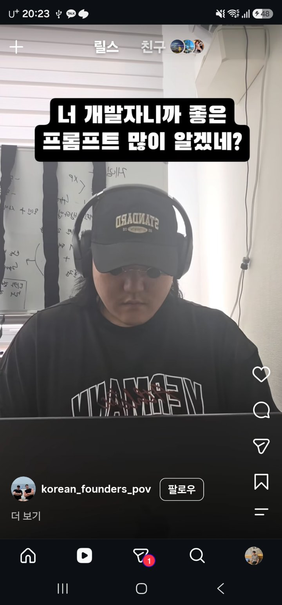
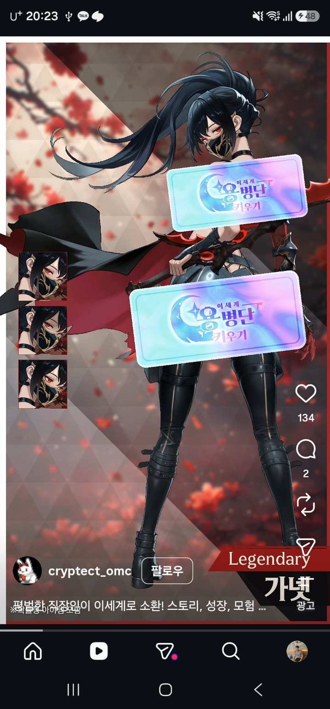
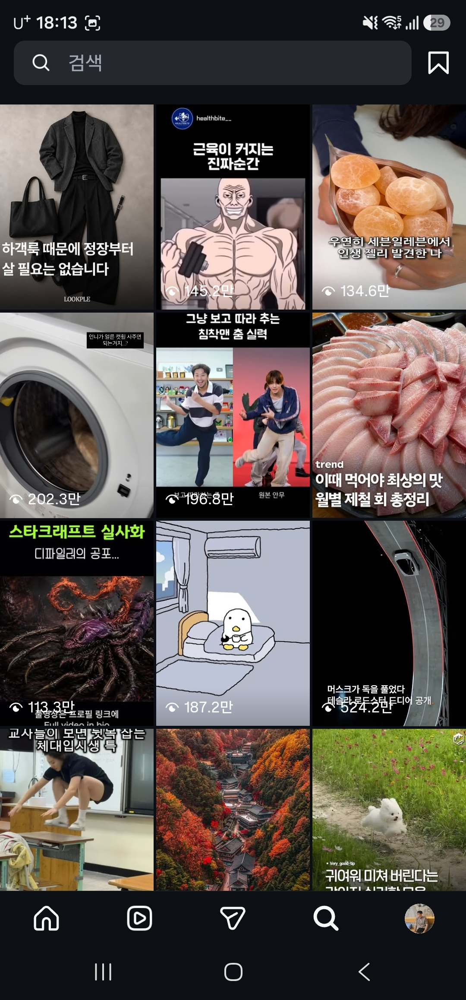
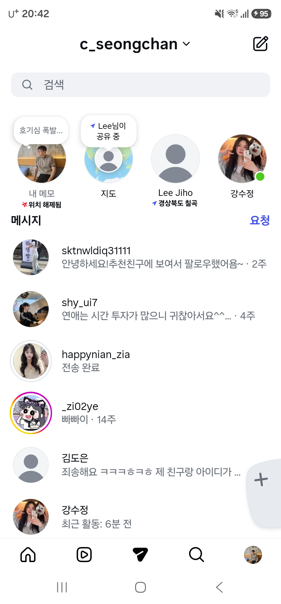
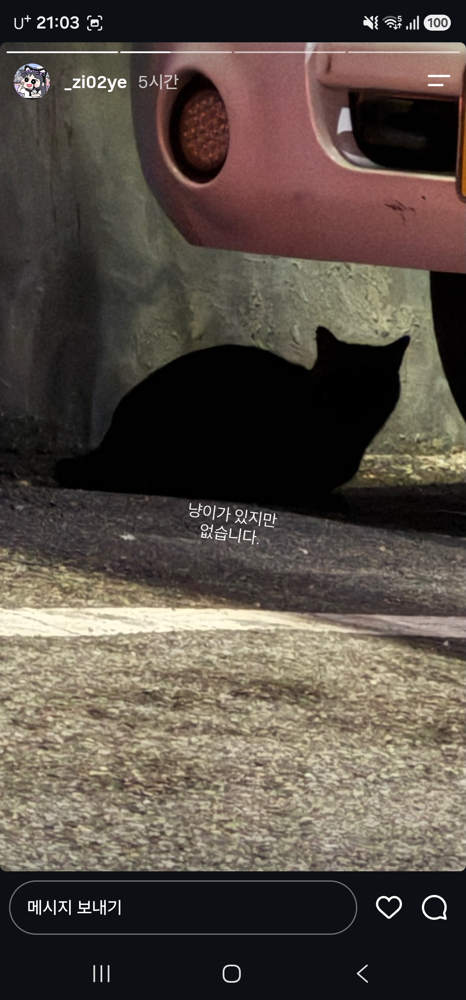

# 인스타그램 숏폼(Reels) 온디바이스 CV 분류 모델 구현 및 학습 기록

## 1. 개요 및 모델 성능
- **담당 역할**: 인스타그램 5-클래스 화면 데이터셋 구축(730장), 전처리 파이프라인 검증, MobileNetV3-Small 모델 하이퍼파라미터 튜닝 및 ONNX 안드로이드 탑재
- **모델 파일**: `app/src/main/assets/models/instagram_shortform_state.onnx` (메타데이터: `instagram_shortform_state.json`)
- **최종 검증 성능**:
  - **Validation Accuracy**: **97.95%** (143 / 146)
  - **Validation Macro F1-Score**: **97.16%**
- **상세 학습 코드 및 출력 로그**: [`DopamineCut.ipynb`](DopamineCut.ipynb) 참조

---

## 2. 5-클래스 정의 및 대표 예시 사진

인스타그램 앱 내부의 화면을 아래 5개 클래스로 분류하여, **오직 `REEL_NORMAL`(일반 릴스)일 때만 시청 시간 및 횟수를 집계**하고 나머지 4개 클래스(광고 및 비숏폼 안전 구역)는 집계에서 제외합니다.

| 클래스 라벨 | 화면 분류 설명 | 확정 임계값 | 대표 예시 사진 |
| :---: | :--- | :---: | :---: |
| **`REEL_NORMAL`** | **일반 릴스 영상 화면** (시청 시간·횟수 집계 및 목표 개입 대상) | `0.65` |  |
| **`REEL_AD`** | **광고/스폰서 릴스 화면** (접근성 및 시각 단서 기반 시청 집계 제외) | `0.75` |  |
| **`FEED_SEARCH`** | **일반 홈 피드 및 검색/탐색 탭** (비숏폼 안전 구역 — 집계 제외) | `0.70` |  |
| **`PROFILE_DM`** | **프로필 및 다이렉트 메시지(DM) 화면** (비숏폼 안전 구역 — 집계 제외) | `0.70` |  |
| **`STORY`** | **상단 스토리 시청 화면** (비숏폼 안전 구역 — 집계 제외) | `0.70` |  |

---

## 3. 모델 학습 하이퍼파라미터 및 훈련 설정

모바일 온디바이스 환경(안드로이드 CPU 스레드 2개 기준)에서의 추론 속도와 분류 정확도를 동시에 확보하기 위해 다음과 같은 하이퍼파라미터와 정규화 기법을 적용하여 파인튜닝을 수행했습니다.

| 구분 | 설정 항목 | 적용 값 / 방식 | 적용 이유 및 비고 |
| :---: | :--- | :--- | :--- |
| **Backbone** | Base Architecture | `MobileNetV3-Small` (ImageNet-1K Pretrained) | 모바일 CPU 저전력·고속 추론에 최적화된 경량 백본 |
| **Input** | 입력 텐서 규격 | `1 × 3 × 320 × 320` (`NCHW`, `RGB`) | `WholeUiTiles` 3분할 UI 타일 합성 + ImageNet 정규화 |
| **Dataset** | 데이터 분할 (Split) | 총 **730장** (Train **584장** / Val **146장**) | `8 : 2` Stratified Split (클래스 비율 유지, `seed=42`) |
| **Training** | Epochs / Batch Size | `Epochs = 25` / `Batch Size = 32` | 최고 검증 Macro F1-Score 달성 시점의 가중치(Best Checkpoint) 저장 |
| **Optimizer** | 최적화 알고리즘 | `AdamW` (`lr = 5e-4`, `weight_decay = 1e-2`) | 가중치 감쇠를 통해 소규모 데이터셋 과적합(Overfitting) 억제 |
| **Scheduler** | 학습률 스케줄러 | `CosineAnnealingLR` (`T_max = 25`, `eta_min = 1e-6`) | 학습 후반부 미세 수렴 유도 및 검증 성능 안정화 |
| **Loss** | 손실 함수 | `CrossEntropyLoss` (Class Weights + `label_smoothing = 0.05`) | 클래스별 샘플 수 불균형 보정 및 모델 과신(Overconfidence) 방지 |
| **Augmentation** | 데이터 증강 | `ColorJitter` (`brightness=0.15`, `contrast=0.15`, `saturation=0.1`) | UI 타일 위치 좌표가 깨지는 좌우 반전/크롭은 배제하고 다크모드·화면 밝기 변화에만 강건하도록 색상 증강 적용 |
| **Export** | 배포 포맷 | `ONNX` (`opset_version = 17`) | 안드로이드 `onnxruntime-android` 완벽 호환 및 SHA-256 무결성 검증 연동 |