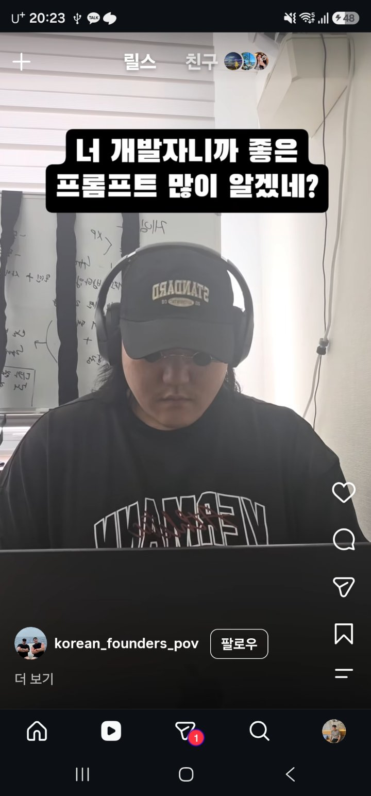
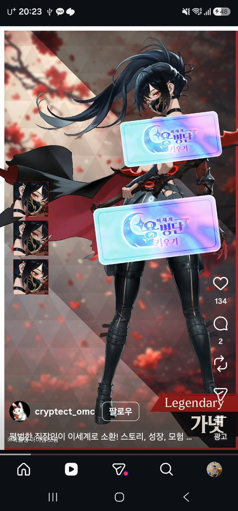
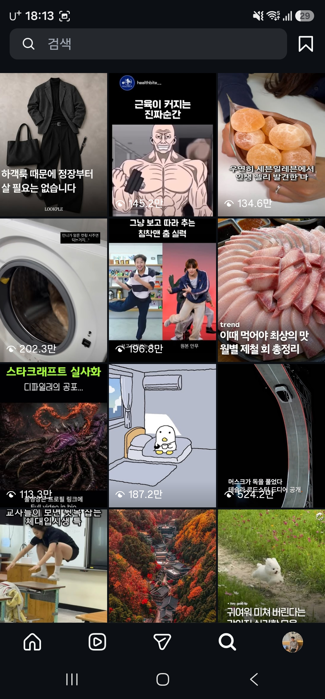
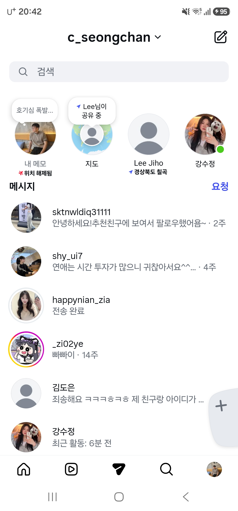
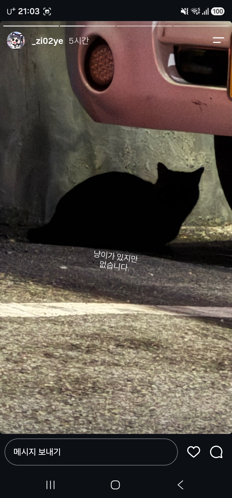
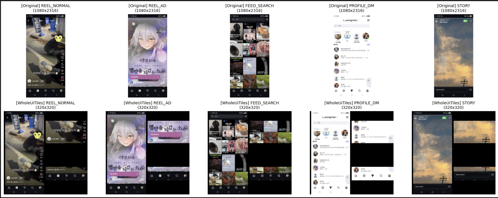
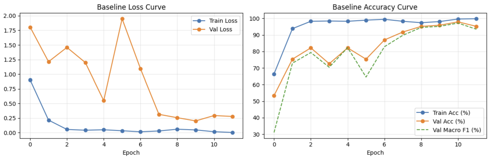
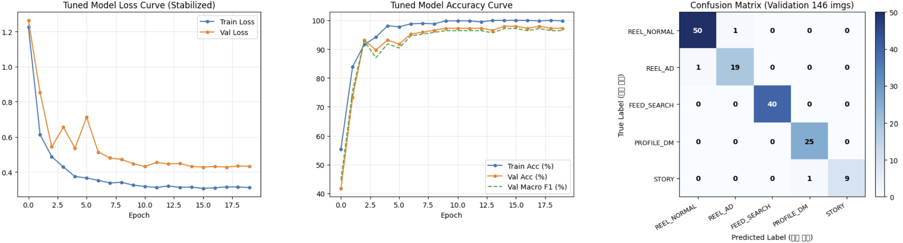
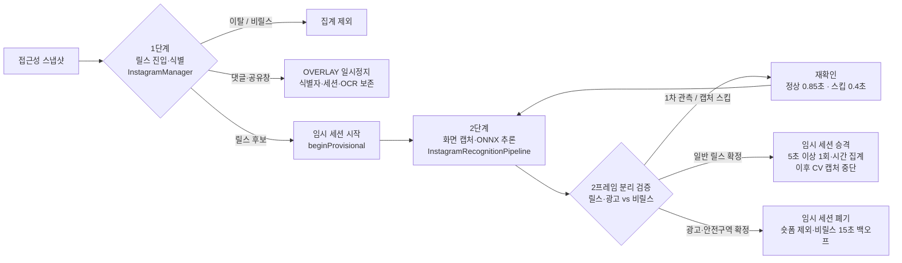

# 인스타그램 숏폼(Reels) 온디바이스 CV 분류 모델 구현 및 통합 검증 결과

## 1. 개요 및 최종 요약
- **담당 역할**: 인스타그램 5-클래스 화면 데이터셋 구축(730장), `WholeUiTiles` 전처리 검증, MobileNetV3-Small 모델 튜닝·ONNX 변환 및 1단계 접근성 추적(`InstagramManager`)과 2단계 온디바이스 CV 파이프라인(`InstagramRecognitionPipeline`)·임시 세션(`AppBlockService`) 최종 통합
- **모델 파일**: `Application/app/src/main/assets/models/instagram_shortform_state.onnx` (5.82 MB / 메타데이터: `instagram_shortform_state.json`)
- **최종 검증 성능 (Validation 146장)**:
  - **Validation Accuracy**: **97.95%** (143 / 146)
  - **Validation Macro F1-Score**: **97.16%**
  - **비숏폼 안전 구역 → 릴스 오탐률**: **0.00%** (0 / 75)
- **상세 학습 코드 및 출력 로그**: [`DopamineCut.ipynb`](DopamineCut.ipynb) 참조

---

## 2. 5-클래스 정의 및 대표 예시 사진

인스타그램 앱 내부의 화면을 아래 5개 클래스로 분류하여, **오직 `REEL_NORMAL`(일반 릴스)일 때만 시청 시간 및 횟수를 집계**하고 나머지 4개 클래스(광고 및 비숏폼 안전 구역)는 집계에서 제외합니다.

| 클래스 라벨 | 화면 분류 설명 | 확정 임계값 | 대표 예시 사진 |
| :---: | :--- | :---: | :---: |
| **`REEL_NORMAL`** | **일반 릴스 영상 화면** (시청 시간·횟수 집계 및 목표 개입 대상) | `0.65` |  |
| **`REEL_AD`** | **광고/스폰서 릴스 화면** (접근성 및 시각 단서 기반 시청 집계 제외) | `0.75` |  |
| **`FEED_SEARCH`** | **일반 홈 피드 및 검색/탐색 탭** (비숏폼 안전 구역 — 집계 제외) | `0.70` |  |
| **`PROFILE_DM`** | **프로필 및 다이렉트 메시지(DM) 화면** (비숏폼 안전 구역 — 집계 제외) | `0.70` |  |
| **`STORY`** | **상단 스토리 시청 화면** (비숏폼 안전 구역 — 집계 제외) | `0.70` |  |

---

## 3. 모델 학습 하이퍼파라미터 및 전처리 (`WholeUiTiles`)

모바일 온디바이스 환경(안드로이드 CPU 스레드 2개 기준)에서의 추론 속도와 분류 정확도를 동시에 확보하기 위해, YouTube·KakaoTalk과 동일한 `WholeUiTiles`(320×320: 좌측 전체 화면 + 우측 중단·하단 UI 2분할) 전처리와 아래 하이퍼파라미터를 적용하여 파인튜닝을 수행했습니다.

| 구분 | 설정 항목 | 적용 값 / 방식 | 적용 이유 및 비고 |
| :---: | :--- | :--- | :--- |
| **Backbone** | Base Architecture | `MobileNetV3-Small` (ImageNet-1K Pretrained, `Dropout = 0.3`) | 모바일 CPU 저전력·고속 추론에 최적화된 경량 백본 및 과적합 방지 |
| **Input** | 입력 텐서 규격 | `1 × 3 × 320 × 320` (`NCHW`, `RGB`) | `WholeUiTiles` 3분할 UI 타일 합성 + ImageNet 정규화 |
| **Dataset** | 데이터 분할 (Split) | 총 **730장** (Train **584장** / Val **146장**) | `8 : 2` Stratified Split (클래스 비율 유지, `seed=42`) |
| **Training** | Epochs / Batch Size | `Epochs = 20` / `Batch Size = 16` | 최고 검증 Macro F1-Score 달성 시점(15 Epoch) 가중치(Best Checkpoint) 저장 |
| **Optimizer** | 최적화 알고리즘 | `AdamW` (`lr = 5e-4`, `weight_decay = 1e-2`) | 가중치 감쇠를 통해 소규모 데이터셋 과적합(Overfitting) 억제 |
| **Scheduler** | 학습률 스케줄러 | `CosineAnnealingLR` (`T_max = 20`, `eta_min = 1e-5`) | 학습 후반부 미세 수렴 유도 및 검증 성능 안정화 |
| **Loss** | 손실 함수 | `CrossEntropyLoss` (Class Weights + `label_smoothing = 0.05`) | 클래스별 샘플 수 불균형 보정 및 모델 과신(Overconfidence) 방지 |
| **Augmentation** | 데이터 증강 | `ColorJitter` (`brightness=0.25`, `contrast=0.25`, `saturation=0.20`, `hue=0.05`) + `RandomAffine` (`degrees=0`, `translate=(0.015, 0.015)`) | UI 타일 위치 좌표가 깨지는 좌우 반전/크롭은 배제하고 다크모드·화면 밝기 변화 및 미세 위치 흔들림(1.5%)에만 강건하도록 증강 적용 |
| **Export** | 배포 포맷 | `ONNX` (`opset_version = 17`, `5.82 MB`) | 안드로이드 `onnxruntime-android` 호환, PyTorch 대비 최대 오차 `0.00002766` 및 SHA-256 무결성 검증 연동 |

### 전처리(`WholeUiTiles`) 적용 샘플

---

## 4. 학습 안정화 및 검증 성능 평가 (Validation 146장)

### 4-1. Baseline vs Tuned 학습 곡선 비교
- **Baseline 모델**: `Adam(lr=1e-3)`, `Batch Size = 32`, `Dropout = 0.2`, 증강·가중치 미적용으로 12 Epoch 학습 시 초기 Validation Loss가 최대 `1.95`(Epoch 6: `1.9489`)까지 급등하며 불안정한 수렴 양상을 보였습니다.
- **Tuned 모델**: `Batch Size = 16`, `Dropout = 0.3`, `AdamW(lr=5e-4, weight_decay=1e-2)`, `CosineAnnealingLR(T_max=20, eta_min=1e-5)`, `Class Weights + label_smoothing=0.05`, `ColorJitter + RandomAffine`을 적용한 결과 Validation Loss가 `label_smoothing(0.05)` 하한 특성상 `0.43`(Best Epoch 15: `0.4320`) 부근에서 급등 없이 안정적으로 수렴하며 최종 **Accuracy 97.95% / Macro F1 97.16%**를 달성했습니다.

| Baseline 학습 곡선 | Tuned 학습 곡선 및 혼동행렬 |
| :---: | :---: |
|  |  |

### 4-2. 클래스별 검증 성능표 (Confusion Matrix 기준)

| 실제 클래스 | 검증 장수 | 정밀도 (Precision) | 재현율 (Recall) | F1-Score | 오분류 내역 |
| :--- | ---: | ---: | ---: | ---: | :--- |
| **`REEL_NORMAL`** | 51 | 98.04% | 98.04% | 98.04% | `REEL_AD` 1장 |
| **`REEL_AD`** | 20 | 95.00% | 95.00% | 95.00% | `REEL_NORMAL` 1장 |
| **`FEED_SEARCH`** | 40 | 100.00% | 100.00% | 100.00% | 없음 |
| **`PROFILE_DM`** | 25 | 96.15% | 100.00% | 98.04% | 없음 |
| **`STORY`** | 10 | 100.00% | 90.00% | 94.74% | `PROFILE_DM` 1장 |
| **전체 / Macro Avg** | **146** | **97.84%** | **96.61%** | **97.16%** | **정답 143 / 146 (97.95%)** |

- **오분류 3건 상세 분석**:
  - `STORY → PROFILE_DM` 1건은 두 클래스 모두 **비숏폼 안전 구역**이므로 실제 앱 집계에서는 100% 동일하게 제외됩니다.
  - 비숏폼 안전 구역(`FEED_SEARCH`, `PROFILE_DM`, `STORY`) 총 **75장 중 일반 릴스(`REEL_NORMAL`) 오탐은 0건**(`0.00%`)입니다.
  - `REEL_NORMAL ↔ REEL_AD` 경계 오분류(각 1건)는 앱 런타임에서 **2프레임 연속 검증**(`ContentKindConfirmation`)을 적용하여 단일 프레임 오탐을 방어하도록 설계했습니다.

---

## 5. 앱 연동 아키텍처 (1단계 접근성 + 2단계 온디바이스 CV 통합)

인스타그램 인식 파이프라인은 **1단계 접근성 추적**(`InstagramManager`)과 **2단계 온디바이스 CV 파이프라인**(`InstagramRecognitionPipeline`), 그리고 **임시 세션 관리**(`AppBlockService` + `ShortformSessionTracker`)가 결합되어 동작합니다.

### 핵심 구현 포인트
1. **릴스·광고 vs 비릴스 2프레임 분리 검증**: `InstagramRecognitionPipeline`에서 단일 프레임 오탐을 막기 위해 `REEL_NORMAL`·`REEL_AD`는 `ContentKindConfirmation`, 비릴스 안전 구역은 별도 연속 카운터(`nonReelStreak`, 4초 윈도우)로 분리 검증하여 광고와 안전 구역 간 교차 오합의를 차단합니다.
2. **임시 세션 연동 및 개입 오버레이·미지원 환경 방어**: `AppBlockService.applyInstagramState`에서 CV 2프레임 대기 중(`UNKNOWN`) 진입 시각을 임시 세션(`beginProvisional`)으로 보존하다가 일반 릴스 확정 시 시청 시간 손실 없이 정식 세션으로 승격(`resolveProvisional`)하고, 광고·안전 구역 확정 시 즉시 폐기합니다. 목표 개입 오버레이 표시 중(`goalPresenter.isShowing`)에는 비동기 추론 결과가 임시 세션을 재개하지 못하도록 차단하며, `cvAvailable` 검사 및 자정 날짜 토큰 검증으로 CV 미지원 환경(Android 10 이하·모델 로드 실패)과 날짜 경계에서의 오집계를 방지합니다.
3. **댓글·공유창 복귀 보존**: 댓글·공유창이 열리면(`OVERLAY`) 진행 중인 CV·OCR 작업과 시청 시간 누적만 일시 정지하고 기존 식별자·세션·누적 OCR 텍스트를 유지하여, 같은 릴스로 복귀 시 중복 집계 없이 이어서 처리합니다.
4. **빠른 스와이프 대응 및 불필요한 화면 캡처 최소화 (발열·배터리 대응)**: 단순 캡처 충돌(`captureSkips`)과 추론 실패(`failures`)를 분리해 1회 캡처 스킵 시 기존 1차 관측과 임시 세션을 유지한 채 `400ms` 뒤 빠르게 재시도하고, 정상 2차 프레임 간격은 `850ms`로 조정해 1초 주기 틱 경계 밀림을 제거했습니다. 확정 후에는 `ContentTrackingCommand.Wait`로 캡처를 즉시 중단하며, 캡처·추론 단계별 2초 타임아웃 방어와 비릴스·연속 오류 시 최대 15초 백오프를 적용했습니다.
5. **기타 콘텐츠(사진 게시물·라이브) 호환**: `countsWatchTime()` 정책을 유지하여 사진 게시물(`PHOTO_POST`)은 숏폼 시청 시간만 반영하고 영상 수에는 포함하지 않습니다.
6. **온디바이스 로컬 처리 (개인정보 보호)**: 화면 캡처 이미지(`Bitmap`)는 외부 서버(Firebase 등)로 전송하거나 디스크에 저장하지 않고, 기기 내부 `onnxruntime-android`로 즉시 분류한 뒤 메모리에서 즉시 해제(`bitmap.recycle()`)합니다.

---

## 6. 실기기 통합 검증 결과

인스타그램 담당 파트(1단계 접근성 추적 + 2단계 온디바이스 CV)의 실기기 테스트 전후 누적값 및 추론 로그 검증 결과입니다.

| 검증 항목 | 테스트 방법 | 결과 (전 → 후 / 로그) | 판정 |
| :--- | :--- | :--- | :---: |
| **1. 모델 로드 및 같은 영상 유지** | 서비스 연결 후 일반 릴스 1개 20초 시청 | 모델 로드·SHA-256 무결성 검증 성공, 숏폼 `0초/0개` → `22초/1개` (앱 사용 `26초`), 세션 유지 | **정상** |
| **2. 다른 영상 전환** | 서로 다른 일반 릴스 2개 각 10초 이상 시청 | 숏폼 `0초/0개` → `21초/2개` (앱 사용 `31초`), 영상별 구분 | **정상** |
| **3-1. 댓글창 복귀** | 영상 10초 → 댓글창 15~18초 → 복귀 시청 | `PLAYER_OVERLAY` 일시정지 후 복귀 시 동일 세션 `count=1` 유지 (`12초→20초`), 댓글창 시간 제외·중복 없음 | **정상** |
| **3-2. 공유창 복귀** | 영상 10초 → 공유창 20초 → 복귀 시청 | 숏폼 `21초/1개` (앱 사용 `47초`), 공유창 시간 제외·중복 없음 | **정상** |
| **4-1. 일반 ↔ 광고 전환** | 일반 릴스 → 광고 릴스 → 일반 릴스 각 10초 이상 시청 | 광고 `REEL_AD (conf=0.884~0.956)` 2프레임 확정 후 `excluded=true` 폐기(`CHECKPOINT` 0건), 양옆 일반 릴스 각 `count=1` 정상 집계 | **정상** |
| **4-2. 기타(사진 게시물)** | 사진 게시물 23초 시청 | 숏폼 `23초/0개` (앱 사용 `28초`), 시간만 반영·횟수 제외 | **정상** |
| **4-3. 기타(라이브)** | 인스타그램 라이브 화면 | 실기기 테스트 시점 표본 미확보 | **미검증** |
| **5. 비숏폼 안전 구역** | 피드 · 검색 · DM · 프로필 · 스토리 각 10초 이상 머무르기 | 1단계 `EXIT_OR_UNIDENTIFIABLE` 제외, 불필요한 캡처 0건, 숏폼 `+0초/+0개` | **정상** |
| **6. 빠른 연속 스와이프 및 CV 추론** | 0.5~1초 간격 4~5개 연속 스와이프 후 마지막 릴스 30초 시청 | 추론 지연 `84~157ms`, 정착 후 약 `1.2~1.4초` 내 2프레임 확정(`conf=0.765~0.928`), 확정 후 추가 캡처 0건, `5→30초 (count=1)` 정상 누적 | **정상** |
| **7. 목표 개입 오버레이 연동** | 목표 도달 시 개입 팝업 표시 후 30초 이상 유지 | 목표 도달 즉시 개입 팝업 표시 및 세션 일시정지, 30초 이상 백그라운드 `CHECKPOINT` 누적·추가 추론 0건 | **정상** |

---

## 7. 한계 및 향후 개선 방향
1. **라이브(`LIVE`) 콘텐츠 실기기 미검증**: 인스타그램 라이브 방송은 테스트 시점 표본을 확보하지 못해 `미검증`으로 표기했으며, 추후 실기기 라이브 표본 확보 후 검증이 필요합니다.
2. **신규 광고 UI 대응**: 검증셋 오분류 3건 중 2건이 `REEL_NORMAL ↔ REEL_AD` 경계에서 발생했습니다. 현재는 2프레임 연속 검증으로 단일 프레임 오탐을 완화하고 있으며, 향후 다양한 형태의 스폰서·쇼핑 태그 광고 캡처를 추가 학습하면 광고 재현율을 더 높일 수 있습니다.