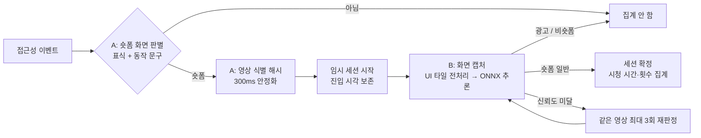
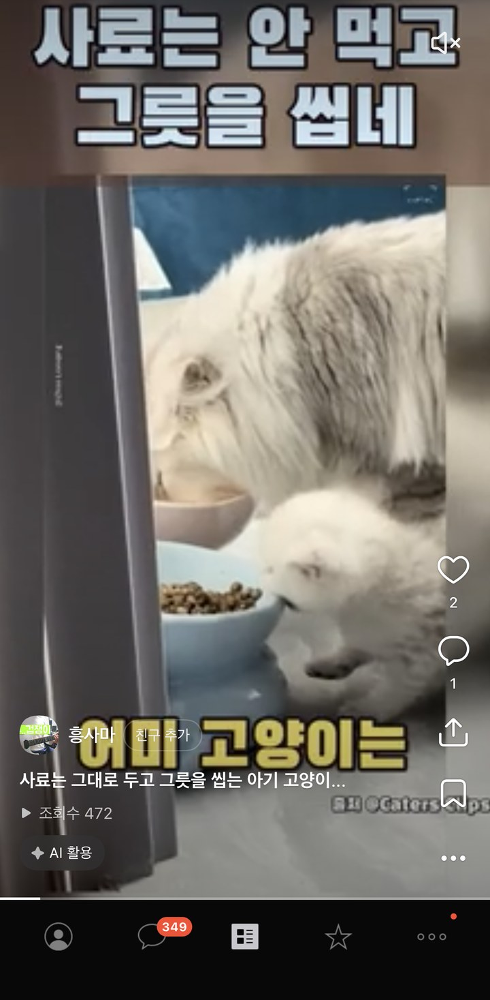
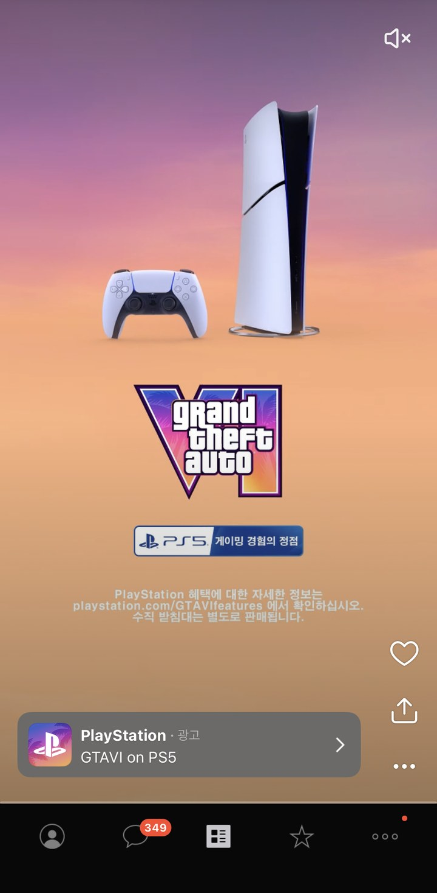
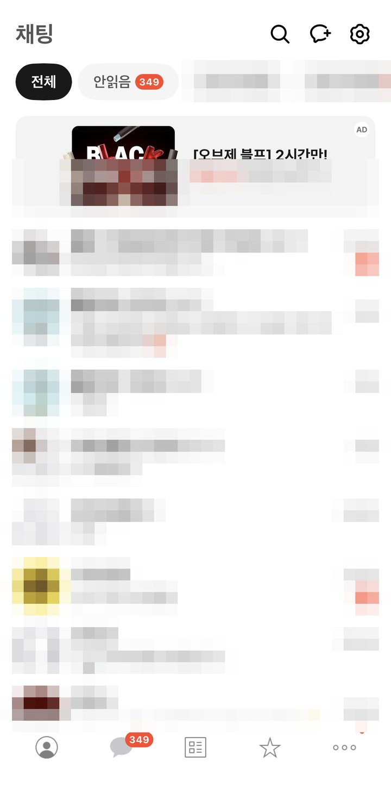
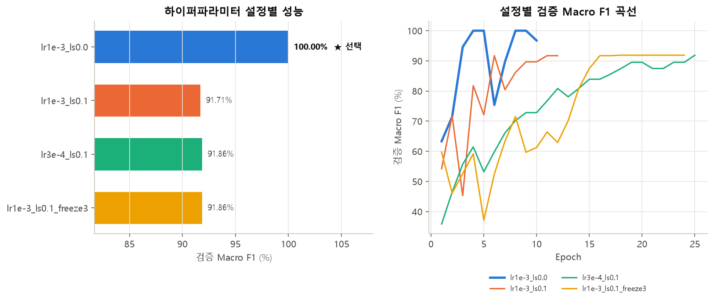
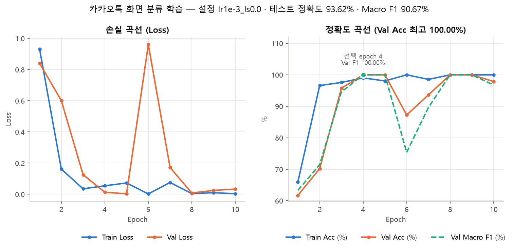
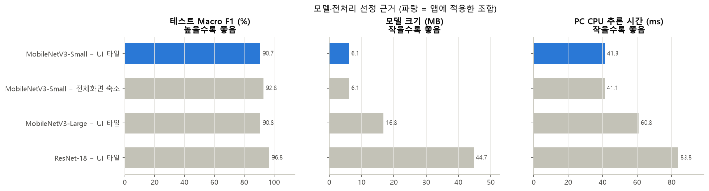
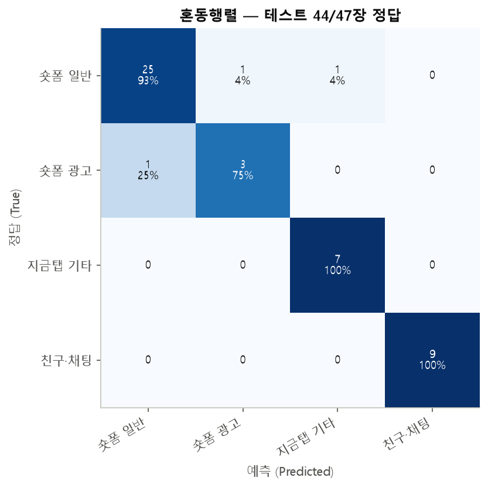
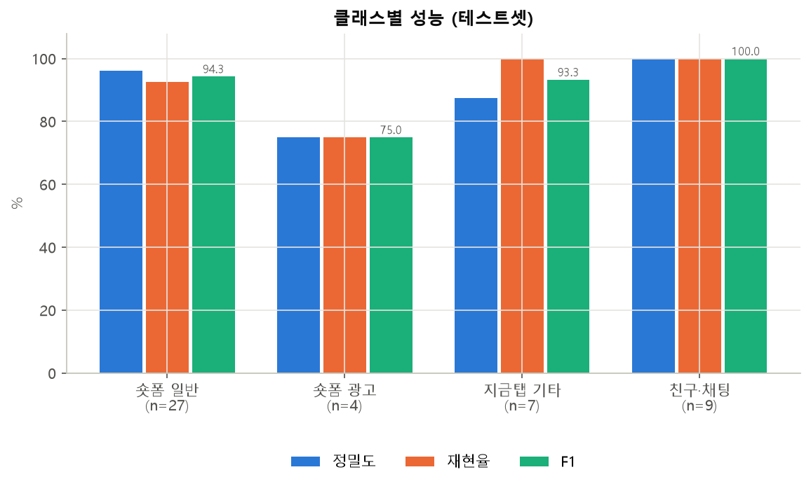

# 카카오톡 숏폼 인식 개선 — 담당 A(탐지·추적) + 담당 B(모델·학습)

## 1. 개요
카카오톡 지금 탭의 숏폼을 시청할 때만 시청 시간·횟수를 집계하도록 두 단계로 인식합니다.

| 구분 | 역할 | 핵심 결과 |
| :---: | :--- | :--- |
| **담당 A** | 숏폼 진입·이탈과 영상 전환을 탐지하고 시청 시간·횟수 집계에 연결 | 300ms 진입 안정화, 1.5초 인식 공백 유예, 오버레이·광고·앱 이탈 처리 |
| **담당 B** | 화면 분류 모델·전처리 선정, 하이퍼파라미터 비교, 최종 모델 앱 연결 | MobileNetV3-Small ONNX, 테스트 정확도 **93.62%** (44/47), Macro F1 **90.67%** |

- **모델 파일**: `app/src/main/assets/models/kakaotalk_shortform_state.onnx` (메타데이터: `kakaotalk_shortform_state.json`)
- **모델 실행 결과**: [`DopamineCut.ipynb`](DopamineCut.ipynb) (앱에 탑재한 ONNX 파일로 테스트셋을 다시 평가한 결과 포함)
- **주요 코드**
  - A: `logic/shortform/KakaotalkTracking.kt`, `logic/manager/KakaotalkManager.kt`
  - B: `logic/shortform/KakaotalkOnDeviceContentClassifier.kt`, 학습 코드 `Application/ml/kakaotalk/`
  - A·B 연결: `service/AppBlockService.kt` (`updateKakaotalkTracking`)

---

## 2. 전체 처리 흐름

A가 "지금 보고 있는 영상이 무엇인지"를 정하면, B가 그 영상 화면이 "일반 숏폼인지, 광고인지, 숏폼이 아닌 화면인지"를 판정합니다. 모델 파일이 없거나 Android 11 미만이면 A의 접근성 기반 추적만으로 동작합니다.

---

## 3. 담당 A — 숏폼 진입·영상 전환 탐지

### 3.1 동작 방식

| 기능 | 구현 내용 |
| :--- | :--- |
| **진입 판별** | `숏폼`·`쇼츠`·`shorts`·`shortform` 표식과 좋아요·댓글·공유 등 동작 문구가 함께 있을 때 숏폼 화면으로 판단 |
| **펑 오탐 제외** | `펑`만 표시된 화면은 숏폼 후보로 보지 않음 |
| **영상 식별** | 버튼·카운터·재생시간 등 변하는 텍스트를 빼고 남은 문구를 정규화해 해시로 식별 (화면 원문은 저장하지 않음) |
| **진입·전환 안정화** | 같은 영상 키가 **300ms** 이어질 때 세션 확정, 다른 키가 잠깐 보이면 기존 세션을 멈추고 확정을 기다림 |
| **오버레이** | 댓글·공유 시트가 열리면 같은 영상 세션을 유지하고 시청 시간만 일시정지 |
| **인식 공백 유예** | 화면 근거가 사라져도 최대 **1.5초** 동안 세션을 멈춘 채 유지 |
| **광고·앱 이탈** | 광고 표시가 있으면 세션 종료, 카카오톡을 벗어나면 추적 상태 초기화 |

### 3.2 예외 상황 시나리오

| 시나리오 | 처리 |
| :--- | :--- |
| 숏폼 진입 | 300ms 안정화 후 세션 확정 (안정화 중에도 임시 세션과 시작 시각 유지) |
| 좋아요 수·재생시간 변경 | 같은 영상 세션 유지 |
| 빠른 영상 넘김 | 짧은 후보 전환으로 기존 세션을 나누지 않음, 5초 미만 영상은 시청 횟수에서 제외 |
| 댓글·공유 열기 | 세션 유지, 오버레이 시간 일시정지 |
| 짧은 화면 인식 공백 | 최대 1.5초 유예 후 이탈 처리 |
| 광고 화면 | 일반 숏폼 시간·횟수에서 제외 |
| 카카오톡 이탈 후 복귀 | 세션 종료, 다시 진입을 확인해야 새 세션 시작 |

---

## 4. 담당 B — 화면 분류 모델

### 4.1 4-클래스 정의 및 대표 예시 사진

**`SHORTFORM_NORMAL`(일반 숏폼)일 때만 시청 시간·횟수를 집계**하고 나머지 3개 클래스는 집계에서 제외합니다. 최고 확률이 임계값보다 낮으면 `UNKNOWN`으로 두고 집계하지 않습니다.

| 클래스 라벨 | 화면 분류 설명 | 확정 임계값 | 대표 예시 사진 |
| :---: | :--- | :---: | :---: |
| **`SHORTFORM_NORMAL`** | **지금 탭 숏폼 일반 영상** (시청 시간·횟수 집계 및 목표 개입 대상) | `0.55` |  |
| **`SHORTFORM_AD`** | **숏폼 사이 광고 화면** (하단 "광고" 표시 — 시청 집계 제외) | `0.55` |  |
| **`NOW_OPENCHAT`** | **지금 탭의 숏폼 외 화면** (오픈채팅 피드·숏폼 모음 카드 — 집계 제외) | `0.55` |  |
| **`CHAT_FRIENDS`** | **친구 목록·채팅 목록 화면** (비숏폼 화면 — 집계 제외) | `0.55` |  |

- 임계값은 검증셋에서 클래스별 정밀도 97% 이상을 만족하는 가장 낮은 값(0.55~0.90 범위)으로 자동 산출했습니다.
- 펑(24시간 스토리)은 수집 표본이 1장뿐이라 클래스에서 제외했습니다. 펑 화면은 A 단계에서 숏폼 후보로 보지 않습니다.
- 예시 사진의 친구 이름·채팅방·대화 내용은 모자이크 처리했습니다.

### 4.2 데이터셋 구성

| 클래스 | 전체 | Train | Val | Test |
| :--- | ---: | ---: | ---: | ---: |
| `SHORTFORM_NORMAL` | 178 | 124 | 27 | 27 |
| `SHORTFORM_AD` | 24 | 16 | 4 | 4 |
| `NOW_OPENCHAT` | 42 | 28 | 7 | 7 |
| `CHAT_FRIENDS` | 56 | 38 | 9 | 9 |
| **합계** | **300** | **206** | **47** | **47** |

- 직접 캡처한 화면을 검수했습니다. 같은 파일이 두 번 들어간 경우는 해시로 중복을 제거하고, 펑 1장과 광고 여부가 애매한 5장은 제외해 300장을 사용했습니다.
- 연속 캡처가 학습·평가에 함께 들어가 점수가 부풀지 않도록 **그룹 단위**로 70 : 15 : 15 분할했습니다(`seed=42`).
- [데이터 수집·라벨링표](../카카오톡_데이터수집_라벨링표.xlsx)는 같은 캡처를 ZIP 파일 경로 기준으로 기록한 표(306행, 중복 포함, 일반 숏폼/광고 2분류)입니다. 모델 학습에는 위 4클래스로 다시 검수한 300장을 사용했습니다.
- 친구 이름·대화가 포함된 원본 캡처는 저장소에 올리지 않았습니다.

### 4.3 모델 학습 하이퍼파라미터 및 훈련 설정

| 구분 | 설정 항목 | 적용 값 / 방식 | 적용 이유 및 비고 |
| :---: | :--- | :--- | :--- |
| **Backbone** | Base Architecture | `MobileNetV3-Small` (ImageNet-1K Pretrained) | 모바일 CPU 저전력·고속 추론에 맞는 경량 백본 |
| **Input** | 입력 텐서 규격 | `1 × 3 × 320 × 320` (`NCHW`, `RGB`) | 인스타그램·유튜브와 같은 `WholeUiTiles` 3분할 UI 타일 + ImageNet 정규화 |
| **Dataset** | 데이터 분할 | 총 **300장** (Train **206** / Val **47** / Test **47**) | 그룹 단위 분할로 같은 영상의 연속 캡처가 평가에 섞이지 않게 함 |
| **Training** | Epochs / Batch Size | 최대 `25` / `32`, 조기 종료 `patience = 6` | 검증 Macro F1 최고 시점의 가중치 저장 |
| **Optimizer** | 최적화 알고리즘 | `AdamW` (`lr = 1e-3`, `weight_decay = 1e-4`) | 4개 설정 비교 후 선택 (4.4절) |
| **Scheduler** | 학습률 스케줄러 | `CosineAnnealingLR` (`T_max = 25`) | 학습 후반 미세 수렴 |
| **Loss** | 손실 함수 | `CrossEntropyLoss` (Class Weights, `label_smoothing = 0.0`) | 광고(24장) 등 소수 클래스 불균형 보정 |
| **Augmentation** | 데이터 증강 | `ColorJitter` (`brightness=0.2`, `contrast=0.2`, `saturation=0.15`) + `RandomErasing` (`p=0.25`) | UI 타일 위치가 바뀌는 반전·크롭은 배제하고 밝기·색상·가림에만 강건하도록 함 |
| **Export** | 배포 포맷 | `ONNX` (`opset_version = 17`) | `onnxruntime-android` 호환, PyTorch와 최대 logit 차이 3.7e-05, SHA-256 무결성 검증 |

### 4.4 하이퍼파라미터 비교

| 설정 | lr | label smoothing | 백본 고정 epoch | 최고 epoch | 검증 정확도 | 검증 Macro F1 |
| :--- | ---: | ---: | ---: | ---: | ---: | ---: |
| **`lr1e-3_ls0.0` (선택)** | 0.001 | 0.0 | 0 | 4 | 100.00% | 100.00% |
| `lr1e-3_ls0.1` | 0.001 | 0.1 | 0 | 6 | 93.62% | 91.71% |
| `lr3e-4_ls0.1` | 0.0003 | 0.1 | 0 | 25 | 93.62% | 91.86% |
| `lr1e-3_ls0.1_freeze3` | 0.001 | 0.1 | 3 | 18 | 93.62% | 91.86% |

검증셋이 47장으로 작아 검증 100%는 과대평가이며, 최종 성능은 테스트셋으로 보고합니다.

### 4.5 모델·전처리 선정

| 후보 | 테스트 정확도 | 테스트 Macro F1 | 크기 | PC CPU 추론 |
| :--- | ---: | ---: | ---: | ---: |
| **MobileNetV3-Small + UI 타일 (앱 적용)** | 93.62% | 90.67% | 6.1MB | 41.3ms |
| MobileNetV3-Small + 전체화면 축소 | 95.74% | 92.82% | 6.1MB | 41.1ms |
| MobileNetV3-Large + UI 타일 | 95.74% | 90.77% | 16.8MB | 60.8ms |
| ResNet-18 + UI 타일 | 97.87% | 96.75% | 44.7MB | 83.8ms |

- **모델**: ResNet-18이 가장 정확하지만 크기 7배, 추론 시간 2배입니다. 접근성 이벤트마다 폰에서 실시간으로 판정해야 하므로 MobileNetV3-Small을 적용했습니다.
- **전처리**: 이번 테스트셋에서 전체화면 축소가 1장 더 맞혔지만, 1장이 약 2.1%포인트라 데이터 규모상 의미 있는 차이로 보기 어렵습니다. 인스타그램·유튜브와 같은 `WholeUiTiles` 전처리 코드를 재사용하기 위해 UI 타일 방식을 유지했습니다.
- 추론 시간은 PC CPU 기준 상대 비교값이며 실기기 값이 아닙니다.

### 4.6 테스트 결과

| 클래스 | 정밀도 | 재현율 | F1 | 장수 |
| :--- | ---: | ---: | ---: | ---: |
| `SHORTFORM_NORMAL` | 96.15% | 92.59% | 94.34% | 27 |
| `SHORTFORM_AD` | 75.00% | 75.00% | 75.00% | 4 |
| `NOW_OPENCHAT` | 87.50% | 100.00% | 93.33% | 7 |
| `CHAT_FRIENDS` | 100.00% | 100.00% | 100.00% | 9 |

- **Accuracy** = 혼동행렬 대각선 합 / 전체 = 44 / 47 = **93.62%**
- **Macro F1** = (94.34 + 75.00 + 93.33 + 100.00) / 4 = **90.67%**
- 오답 3장: 숏폼 일반 → 광고 1장, 숏폼 일반 → 지금탭 기타 1장, 광고 → 숏폼 일반 1장

---

## 5. A·B 연결 (앱 동작)

`AppBlockService.updateKakaotalkTracking`에서 두 단계를 연결합니다.

1. A의 `KakaotalkTrackingCoordinator`가 숏폼 진입과 영상 키를 확정합니다.
2. 확정된 영상마다 B의 `KakaotalkOnDeviceContentClassifier`가 화면을 캡처해 한 번 판정합니다. 판정 전에는 진입 시각을 보존하는 임시 세션(집계 제외)으로 둡니다.
3. 일반 숏폼이면 임시 세션을 확정해 집계하고, 광고·비숏폼이면 집계하지 않습니다.
4. 신뢰도가 임계값보다 낮으면 화면 전환 중일 수 있으므로 같은 영상에서 최대 3회까지 다시 판정합니다.
5. 모델은 로드할 때 SHA-256, 라벨 순서, 입출력 규격, 전처리 규격을 metadata JSON과 대조하고, 실패하면 A의 접근성 기반 추적만 사용합니다.

Logcat 필터 `tag:AppBlockService` → `KakaoTalk 콘텐츠 판정: uiClass=..., verdict=..., conf=..., latencyMs=...`

---

## 6. 검증

| 테스트 | 담당 | 확인 내용 | 결과 |
| :--- | :---: | :--- | :---: |
| `KakaotalkTrackingTest` | A | 진입 안정화, 안정화 중 임시 세션 유지, 같은 영상 유지, 빠른 넘김, 영상 전환, 앱 복귀, 댓글 오버레이, 광고 제외, 시청 시간·횟수 집계, 5초 미만 영상 제외 | 10 / 10 통과 |
| `KakaotalkScreenDecisionTest` | B | 임계값 확정, 광고·비숏폼 제외, 신뢰도 미달 시 UNKNOWN, 잘못된 출력 거부 | 5 / 5 통과 |
| `KakaotalkPreprocessingParityTest` | B | Python `ui_tiles_v1`과 앱 `WholeUiTiles.kt`가 3개 종횡비에서 픽셀 단위로 일치 | 1 / 1 통과 |
| `KakaotalkOnDeviceClassifierInstrumentedTest` | B | 안드로이드 에뮬레이터에서 모델 로드·체크섬 검증·ONNX 추론, Python 결과와 확률 일치 | 통과 |

단위 테스트는 현재 `main` 기준으로 실행했습니다.

---

## 7. 한계 및 다음 작업
1. 카카오톡 실기기에서 A 추적과 B 판정이 함께 동작하는지(진입·이탈·빠른 넘김·광고) 아직 확인하지 못했습니다.
2. 학습 캡처가 iPhone 화면입니다. 안드로이드 실기기 캡처로 추가 평가가 필요합니다.
3. 테스트셋이 47장(광고 4장)으로 작아 광고 F1은 1장 차이로 크게 변합니다. 광고 표본을 더 모아야 합니다.
4. A의 화면 판별은 접근성 텍스트 기준입니다. 실기기 접근성 ID를 기록하면 판별 근거를 보강할 수 있습니다.
5. 펑은 표본 부족으로 모델 클래스에서 제외했습니다.

---

## 8. 관련 자료
- [담당 A 구현 기록](../카카오톡_A담당_구현검증_기록.md) · [담당 A 체크리스트](../카카오톡_A담당_시작체크리스트.md)
- [담당 B 모델 학습 결과](../담당B_모델_학습_결과.md) · [분류 모델 결과 요약](../카카오톡_분류모델_결과요약.md)
- [데이터 수집·라벨링표](../카카오톡_데이터수집_라벨링표.xlsx)
