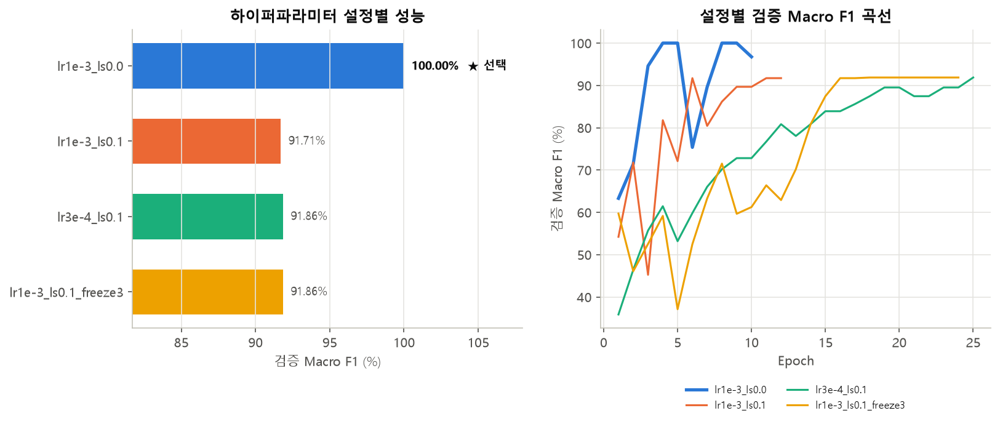
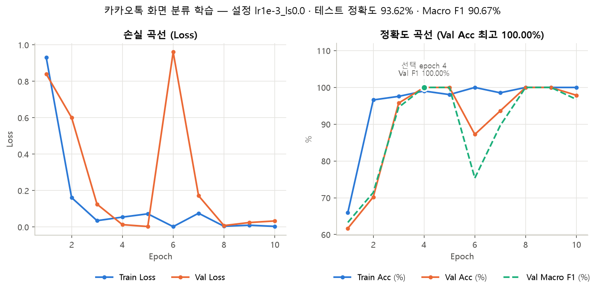
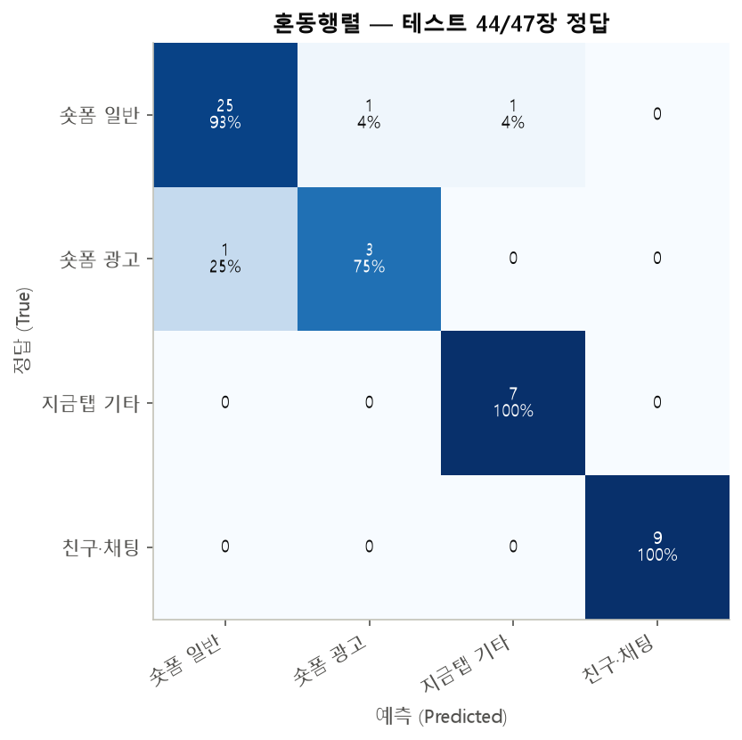
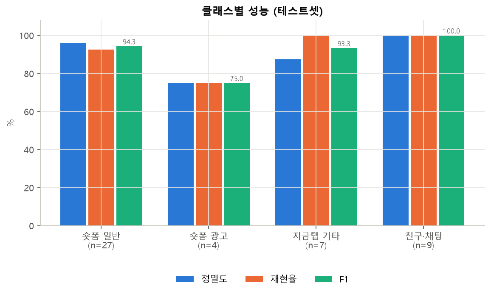
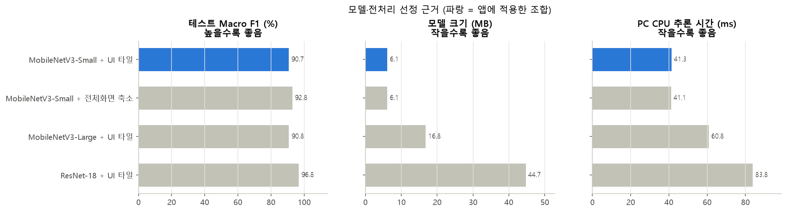

# 카카오톡 숏폼 인식 개선 — 담당 B (모델·학습)

## 역할과 범위
- 담당: 카카오톡 파트 B(플랫폼에 맞는 모델·전처리 선정, 하이퍼파라미터 비교, 최종 모델 앱 연결)
- 담당 A의 진입·이탈·영상 전환 추적 흐름 위에, 영상마다 화면 분류 모델의 판정을 더해 일반 숏폼만 집계하도록 연결

## 결과 요약
| 항목 | 값 |
|---|---|
| 모델 | MobileNetV3-Small (ImageNet 사전학습), ONNX 6.1MB |
| 전처리 | `ui_tiles_v1` 320×320 (전체 화면 + 높이 60~85% + 82~97%, 비율 유지·검은 패딩) — 인스타그램·유튜브와 동일 |
| 학습 데이터 | 카카오톡 화면 캡처 300장 (4개 클래스) |
| **테스트 정확도** | **44 / 47 = 93.62%** |
| **테스트 Macro F1** | **90.67%** |
| PyTorch ↔ ONNX 최대 logit 차이 | 3.7e-05 (ONNX 테스트 정확도 동일) |

## 1. 데이터
### 클래스 정의
| 라벨 | 화면 | 앱 처리 |
|---|---|---|
| `SHORTFORM_NORMAL` | 지금 탭 숏폼 일반 영상 | 시청 시간·횟수 집계 |
| `SHORTFORM_AD` | 숏폼 사이 광고(화면 하단 "광고" 표시) | 집계 제외 |
| `NOW_OPENCHAT` | 지금 탭의 숏폼 외 화면(오픈채팅 피드, 숏폼 모음 카드 등) | 집계 제외 |
| `CHAT_FRIENDS` | 친구 목록·채팅 목록 | 집계 제외 |

- 클래스별 신뢰도가 임계값(검증셋 정밀도 97% 기준으로 산출, 현재 0.55)보다 낮으면 `UNKNOWN`으로 두고 집계하지 않는다.
- 펑(24시간 스토리)은 수집 표본이 1장뿐이라 학습 클래스에서 제외했다. 펑 화면은 낮은 신뢰도로 `UNKNOWN` 처리되는 것을 기대하며, 실기기 확인이 필요하다.

### 수집·검수
- 고유 캡처 306장을 수집하고 직접 라벨을 검수했다. 같은 파일이 두 번 들어간 경우는 내용(해시) 기준으로 중복을 제거했다.
- 펑 1장과 광고 여부가 애매한 5장("구매하기" 카드에 광고 표시가 없는 화면, 빈 로딩 화면, 카카오 소식 안내 화면)은 학습에서 제외했다.
- 수집 기기: iPhone (1206×2622). 앱은 안드로이드에서 동작하므로 안드로이드 화면에서의 정확도는 별도 확인이 필요하다.
- 친구 이름·대화가 보이는 원본 캡처는 저장소에 올리지 않았다(`ml/kakaotalk/data/`는 `.gitignore` 처리).

### 분할
연속 캡처가 학습·평가에 동시에 들어가지 않도록 그룹 단위로 나눴다(학습 70% / 검증 15% / 테스트 15%).

| 분할 | 숏폼 일반 | 숏폼 광고 | 지금탭 기타 | 친구·채팅 | 합계 |
|---|---:|---:|---:|---:|---:|
| train | 124 | 16 | 28 | 38 | 206 |
| val | 27 | 4 | 7 | 9 | 47 |
| test | 27 | 4 | 7 | 9 | 47 |
| 합계 | 178 | 24 | 42 | 56 | 300 |

## 2. 하이퍼파라미터 비교
AdamW, Cosine 스케줄, 최대 25 epoch, 검증 Macro F1이 6 epoch 동안 오르지 않으면 조기 종료. 학습률·라벨 스무딩·백본 고정을 비교했다.

| 설정 | lr | label smoothing | 백본 고정 epoch | 최고 epoch | 검증 정확도 | 검증 Macro F1 |
|---|---:|---:|---:|---:|---:|---:|
| **lr1e-3_ls0.0 (선택)** | 0.001 | 0.0 | 0 | 4 | 100.00% | 100.00% |
| lr1e-3_ls0.1 | 0.001 | 0.1 | 0 | 6 | 93.62% | 91.71% |
| lr3e-4_ls0.1 | 0.0003 | 0.1 | 0 | 25 | 93.62% | 91.86% |
| lr1e-3_ls0.1_freeze3 | 0.001 | 0.1 | 3 | 18 | 93.62% | 91.86% |



- 검증셋이 47장으로 작아 검증 100%는 과대평가이며, 최종 성능은 선택에 쓰지 않은 테스트셋으로 보고한다.



## 3. 테스트 결과
### 정확도
혼동행렬 대각선 합 44 / 전체 47 = **93.62%**



틀린 3장: 숏폼 일반 → 광고 1장, 숏폼 일반 → 지금탭 기타 1장, 광고 → 숏폼 일반 1장.

### Macro F1
각 클래스 F1을 구한 뒤 클래스 수(4)로 나눈 값.

| 클래스 | 정밀도 | 재현율 | F1 | 장수 |
|---|---:|---:|---:|---:|
| 숏폼 일반 | 96.15% | 92.59% | 94.34% | 27 |
| 숏폼 광고 | 75.00% | 75.00% | 75.00% | 4 |
| 지금탭 기타 | 87.50% | 100.00% | 93.33% | 7 |
| 친구·채팅 | 100.00% | 100.00% | 100.00% | 9 |

Macro F1 = (94.34 + 75.00 + 93.33 + 100.00) / 4 = **90.67%**



## 4. 모델·전처리 선정
같은 분할·하이퍼파라미터로 후보를 학습해 비교했다.

| 후보 | 테스트 정확도 | 테스트 Macro F1 | 파라미터(M) | 크기(MB) | PC CPU 추론(ms) |
|---|---:|---:|---:|---:|---:|
| **MobileNetV3-Small + UI 타일 (적용)** | 93.62% | 90.67% | 1.52 | 6.1 | 41.3 |
| MobileNetV3-Small + 전체화면 축소 | 95.74% | 92.82% | 1.52 | 6.1 | 41.1 |
| MobileNetV3-Large + UI 타일 | 95.74% | 90.77% | 4.21 | 16.8 | 60.8 |
| ResNet-18 + UI 타일 | 97.87% | 96.75% | 11.18 | 44.7 | 83.8 |



- **모델:** ResNet-18이 가장 높지만 크기가 7배, 추론 시간이 2배다. 접근성 이벤트마다 폰에서 실시간으로 판정해야 하므로 가장 작고 빠른 MobileNetV3-Small을 선택했다.
- **전처리:** 이번 테스트셋에서는 전체화면 축소가 1장 더 맞혔다. 테스트 1장이 약 2.1%포인트라 이 차이는 데이터 규모상 의미 있는 차이로 보기 어렵다. 인스타그램·유튜브와 같은 `WholeUiTiles` 전처리를 공유해 앱 코드를 재사용할 수 있으므로 UI 타일 방식을 유지했다.
- 추론 시간은 PC CPU 기준 상대 비교용이며 실기기 값이 아니다.

## 5. 앱 연결
- `KakaotalkOnDeviceContentClassifier`: ONNX 로드 시 SHA-256, 라벨 순서, 입출력 규격, 전처리 규격을 metadata JSON과 대조해 검증한다.
- `AppBlockService.updateKakaotalkTracking`: 담당 A의 추적 흐름이 영상 키를 확정하면, 그 영상에 대해 화면을 캡처해 한 번 판정한다.
  - 판정 전에는 진입 시각을 보존하는 임시 세션(집계 제외)으로 둔다.
  - 일반 숏폼 → 임시 세션을 확정해 집계, 광고 → 임시 세션을 버리고 제외, 비숏폼 → 제외.
  - 신뢰도 미달은 화면 전환 중일 수 있으므로 같은 영상에서 최대 3회까지 재판정한다.
  - 모델 파일이 없거나 Android 11 미만이면 담당 A의 접근성 기반 추적만으로 동작한다.
- Logcat 필터 `tag:AppBlockService`에서 `KakaoTalk 콘텐츠 판정: uiClass=..., conf=..., latencyMs=...`로 확인할 수 있다.

## 6. 검증
- Python 학습 전처리와 앱 `WholeUiTiles`가 서로 다른 3개 종횡비에서 픽셀 단위로 일치함을 단위 테스트(`KakaotalkPreprocessingParityTest`)로 확인했다.
- 판정 로직(임계값, 비숏폼 제외, 잘못된 출력 거부)을 단위 테스트(`KakaotalkScreenDecisionTest`)로 확인했다.
- 안드로이드 에뮬레이터에서 모델 로드·체크섬 검증·ONNX 추론이 동작하고 Python 결과와 확률이 일치함을 기기 테스트로 확인했다.

## 한계와 다음 작업
1. 학습 캡처가 iPhone 화면이다. 안드로이드 실기기 캡처를 추가해 재학습·평가해야 한다.
2. 테스트셋이 47장(광고 4장)으로 작아 광고 F1은 1장 차이로 크게 변한다. 광고 표본을 더 모아야 한다.
3. 펑 클래스는 표본 부족으로 제외했다. 펑 화면에서 집계가 되지 않는지 실기기에서 확인해야 한다.
4. 카카오톡 실기기에서 담당 A 추적 흐름과 함께 동작하는지(진입·이탈·빠른 스크롤·광고) 아직 확인하지 못했다.

## 재현 방법
학습·평가 코드는 `Application/ml/kakaotalk/`에 있다(사용법은 해당 폴더 README).

```bash
python run_all.py   # 검수 요약 → 학습 → 모델 비교 → 그래프 → ONNX 변환·앱 설치
```
