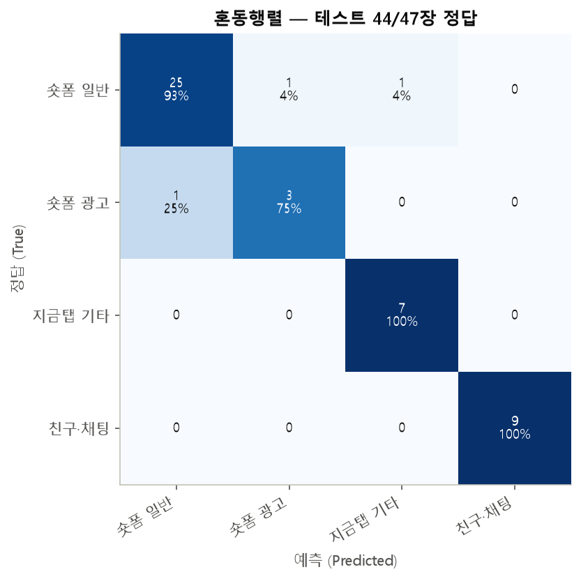
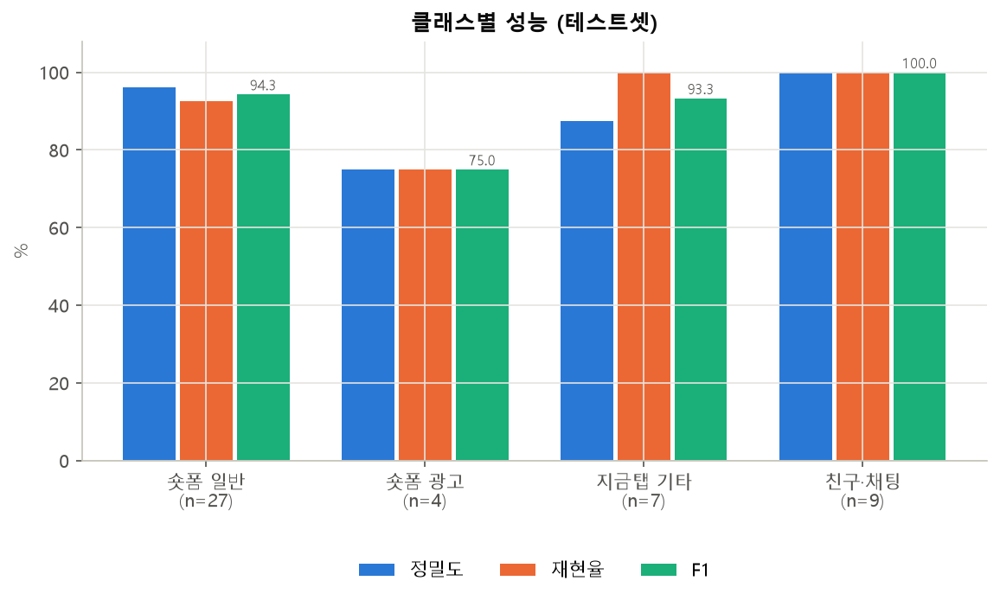
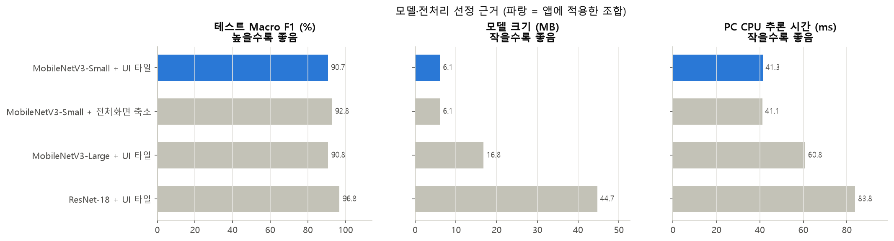

# 카카오톡 숏폼 분류 모델 결과

## 결과 요약

| 항목 | 결과 |
|---|---|
| 분류 클래스 | 4개: 숏폼 일반, 숏폼 광고, 지금 탭 기타, 친구·채팅 |
| 앱 적용 모델 | MobileNetV3-Small, ONNX 6.1MB |
| 테스트 세트 | 47장 |
| 테스트 정확도 | 44/47, 93.62% |
| 테스트 Macro F1 | 90.67% |
| PyTorch·ONNX 비교 | 테스트 정확도 동일, 최대 logit 차이 3.7×10⁻⁵ |
| 앱 판정 로그 | `AppBlockService` 태그로 클래스·신뢰도·`latencyMs` 출력 |

## 클래스별 테스트 결과

| 실제 클래스 | 테스트 수 | 정밀도 | 재현율 | F1 |
|---|---:|---:|---:|---:|
| 숏폼 일반 | 27 | 96.15% | 92.59% | 94.34% |
| 숏폼 광고 | 4 | 75.00% | 75.00% | 75.00% |
| 지금 탭 기타 | 7 | 87.50% | 100.00% | 93.33% |
| 친구·채팅 | 9 | 100.00% | 100.00% | 100.00% |

## 모델 선택과 추론 시간

비교 실험 중 ResNet-18이 테스트 정확도 97.87%로 가장 높았습니다. 앱에는 모델 크기와 처리 부담을 함께 고려해 MobileNetV3-Small을 적용했습니다. 선택 모델의 테스트 정확도는 93.62%이며, 성능 비교 자료의 추론 시간은 PC CPU 측정값입니다.

| 모델 | 테스트 정확도 | 테스트 Macro F1 | 모델 크기 | PC CPU 추론 시간 |
|---|---:|---:|---:|---:|
| MobileNetV3-Small (앱 적용) | 93.62% | 90.67% | 6.1MB | 41.3ms |
| ResNet-18 (비교 후보) | 97.87% | 96.75% | 44.7MB | 83.8ms |

앱에서는 접근성 화면 판정 시 Logcat에 `uiClass`, `verdict`, 신뢰도, 추론 소요시간 `latencyMs`를 출력하도록 연결되어 있습니다. Logcat 필터는 `AppBlockService`입니다.

## 데이터 기준

사용자 제공 캡처 라벨표와 모델 학습 결과는 각각 별도로 집계된 자료입니다. 라벨표에는 306행(일반 숏폼 283, 광고 23)이 기록되어 있고, 모델 보고서에는 학습·검증·테스트에 사용한 300장과 4개 클래스별 분할 수가 기록되어 있습니다.

## 관련 자료

- [모델 학습 및 하이퍼파라미터 상세 결과](./담당B_모델_학습_결과.md)
- [캡처 데이터 수집·라벨링표](./카카오톡_데이터수집_라벨링표.xlsx)
- [학습 곡선](./assets/01_learning_curves.png)
- [하이퍼파라미터 비교](./assets/04_hparam_comparison.png)
