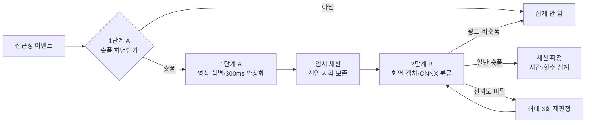
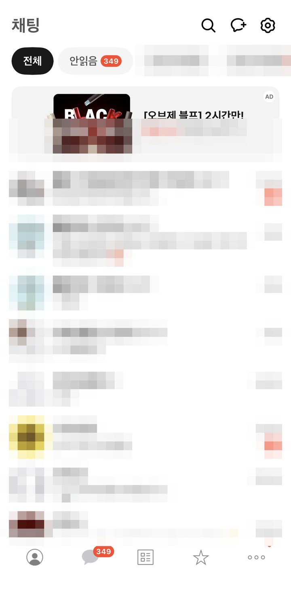
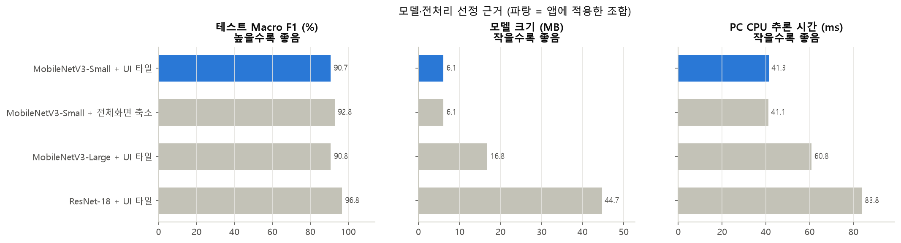
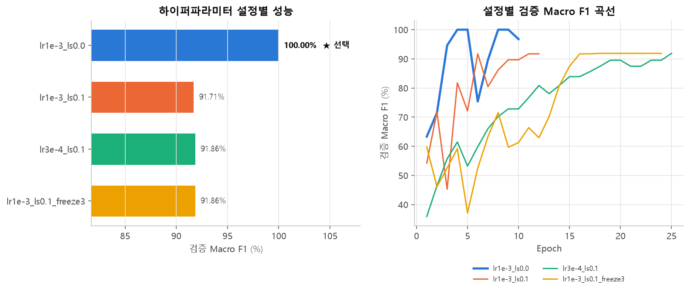
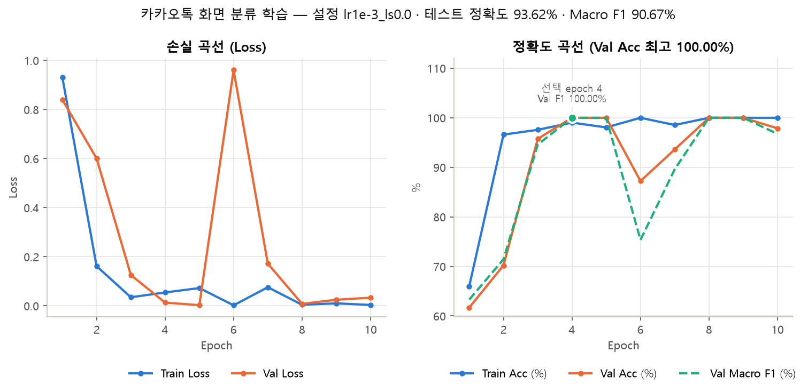
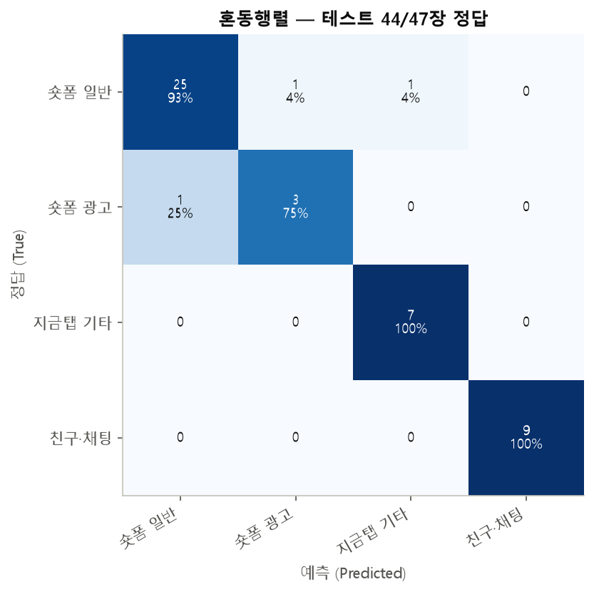
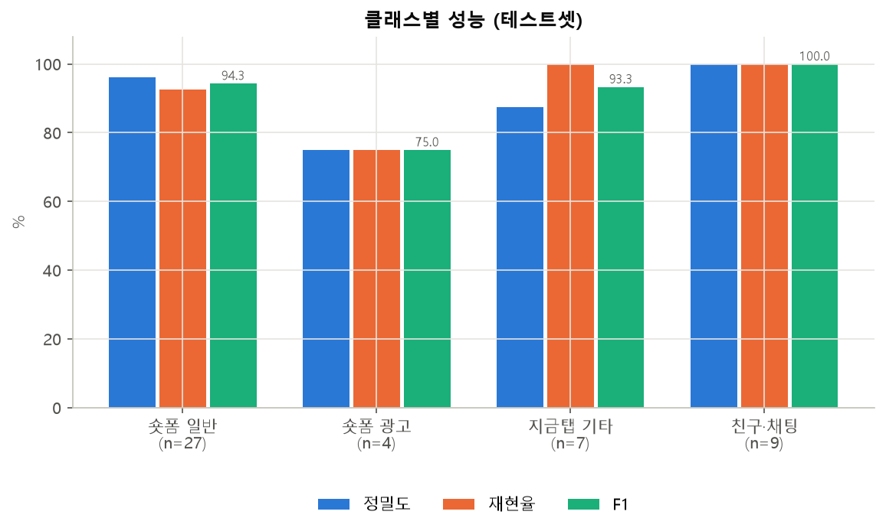

# 카카오톡 숏폼 인식 통합 결과 (담당 A + 담당 B)

카카오톡 숏폼 인식은 **두 단계**로 동작합니다. 1단계(담당 A)가 접근성 정보로 "지금 숏폼을 보고 있는지, 어떤 영상인지"를 정하고, 2단계(담당 B)가 그 영상 화면을 캡처해 "일반 숏폼인지, 광고인지, 숏폼이 아닌 화면인지"를 판정합니다. 두 단계를 모두 통과한 일반 숏폼만 시청 시간·횟수에 들어갑니다.

## 요약

- **1단계 탐지(A)**: 숏폼 표식과 동작 문구로 진입 판별, 영상 문구 해시로 영상 식별, 300ms 안정화·1.5초 공백 유예로 오탐 방지
- **2단계 분류(B)**: MobileNetV3-Small ONNX(6.1MB)로 카카오톡 화면 4종 분류, 테스트 정확도 **93.62% (44/47)**, Macro F1 **90.67%**
- **검증**: 카카오톡 단위 테스트 16개(A 10, B 6) 통과, 에뮬레이터에서 앱 코드로 테스트셋 47장을 분류해 44장 정답(Python 결과와 47장 모두 동일)

## 인식 흐름

---

## 1단계 — 숏폼 진입·영상 전환 탐지 (담당 A)

코드: `logic/shortform/KakaotalkTracking.kt`, `logic/manager/KakaotalkManager.kt`

**판별 근거**

- 화면에 `숏폼`·`쇼츠`·`shorts`·`shortform` 중 하나와 `좋아요`·`댓글`·`공유` 같은 영상 동작 문구가 함께 있으면 숏폼 화면으로 봅니다.
- `펑`만 표시된 화면은 숏폼 후보로 보지 않습니다.
- 영상은 버튼·카운터·재생시간처럼 바뀌는 텍스트를 뺀 나머지 문구를 정규화한 해시로 구분합니다. 화면 원문은 저장하지 않습니다.

**흔들림 처리**

| 상황 | 동작 |
| :--- | :--- |
| 처음 진입 | 같은 영상 키가 300ms 이어지면 세션 확정 (그 사이에도 임시 세션과 시작 시각 유지) |
| 좋아요 수·재생시간만 변함 | 같은 영상으로 유지 |
| 영상을 빠르게 넘김 | 잠깐 보인 영상으로 세션을 나누지 않음, 5초 미만 시청은 횟수에서 제외 |
| 댓글·공유 창 열기 | 같은 영상 유지, 그 시간은 일시정지 |
| 화면 근거가 잠깐 사라짐 | 최대 1.5초 기다린 뒤 이탈 처리 |
| 광고 표시 | 세션 종료, 집계 제외 |
| 카카오톡을 벗어남 | 추적 상태 초기화, 돌아오면 진입부터 다시 확인 |

---

## 2단계 — 화면 분류 모델 (담당 B)

코드: `logic/shortform/KakaotalkOnDeviceContentClassifier.kt`, 학습·평가 [`training/`](./training/)

### 분류 기준

| 라벨 | 화면 | 시청 집계 |
| :--- | :--- | :---: |
| `SHORTFORM_NORMAL` | 지금 탭 숏폼 일반 영상 | O |
| `SHORTFORM_AD` | 숏폼 사이 광고(하단 "광고" 표시) | X |
| `NOW_OPENCHAT` | 지금 탭의 숏폼 외 화면(오픈채팅 피드, 숏폼 모음 카드) | X |
| `CHAT_FRIENDS` | 친구 목록·채팅 목록 | X |

| 숏폼 일반 | 숏폼 광고 | 지금 탭 기타 | 친구·채팅 |
| :---: | :---: | :---: | :---: |
|  |  |  |  |

예시 화면은 상단 상태바를 잘라내고 친구 이름·채팅방·대화를 모자이크했습니다. 가장 높은 확률이 0.55(검증셋 정밀도 97% 기준으로 산출)보다 낮으면 어느 라벨로도 확정하지 않고 집계에서 뺍니다. 펑은 수집 표본이 1장뿐이라 라벨에서 제외했습니다.

### 데이터

직접 캡처한 화면 306장을 검수해 중복과 애매한 화면(펑 1장, 광고 여부가 불분명한 5장)을 빼고 300장을 썼습니다. 같은 영상을 연속으로 찍은 캡처가 학습과 평가에 나뉘어 들어가지 않도록 묶음 단위로 나눴습니다.

| | 숏폼 일반 | 광고 | 지금 탭 기타 | 친구·채팅 | 합계 |
| :--- | ---: | ---: | ---: | ---: | ---: |
| 학습 | 124 | 16 | 28 | 38 | 206 |
| 검증 | 27 | 4 | 7 | 9 | 47 |
| 테스트 | 27 | 4 | 7 | 9 | 47 |

[데이터 수집·라벨링표](./카카오톡_데이터수집_라벨링표.xlsx)는 같은 캡처를 압축 파일 경로 기준으로 적은 표(306행, 일반 숏폼/광고 2분류)이고, 모델에는 위 4종으로 다시 검수한 300장을 사용했습니다. 원본 캡처는 개인정보가 있어 저장소에 올리지 않았습니다.

### 모델을 고른 과정

**① 모델·입력 방식 후보 비교** — 같은 데이터 분할로 네 가지를 학습했습니다.

| 후보 | 테스트 정확도 | Macro F1 | 크기 | PC 추론 |
| :--- | ---: | ---: | ---: | ---: |
| MobileNetV3-Small + UI 타일 **(채택)** | 93.62% | 90.67% | 6.1MB | 41.3ms |
| MobileNetV3-Small + 전체 화면 축소 | 95.74% | 92.82% | 6.1MB | 41.1ms |
| MobileNetV3-Large + UI 타일 | 95.74% | 90.77% | 16.8MB | 60.8ms |
| ResNet-18 + UI 타일 | 97.87% | 96.75% | 44.7MB | 83.8ms |

- ResNet-18이 가장 정확하지만 7배 크고 2배 느립니다. 화면이 바뀔 때마다 폰에서 바로 판정해야 하므로 가장 가볍고 빠른 MobileNetV3-Small을 택했습니다.
- 입력 방식은 전체 화면 축소가 테스트에서 1장 더 맞혔지만, 테스트 1장이 약 2.1%포인트라 차이를 단정하기 어렵습니다. 앱이 이미 다른 플랫폼에 쓰는 `WholeUiTiles`(전체 화면 + 하단 두 띠를 한 장에 배치)를 그대로 쓸 수 있어 UI 타일을 유지했습니다.
- 추론 시간은 PC CPU에서 잰 상대값입니다.

**② 학습 설정 비교** — 학습률, 라벨 스무딩, 앞부분 고정 여부를 바꿔 검증 Macro F1로 비교했습니다.

| 설정 | 학습률 | 라벨 스무딩 | 앞부분 고정 | 검증 정확도 | 검증 Macro F1 |
| :--- | ---: | ---: | ---: | ---: | ---: |
| **lr1e-3_ls0.0 (채택)** | 0.001 | 0.0 | 없음 | 100.00% | 100.00% |
| lr1e-3_ls0.1 | 0.001 | 0.1 | 없음 | 93.62% | 91.71% |
| lr3e-4_ls0.1 | 0.0003 | 0.1 | 없음 | 93.62% | 91.86% |
| lr1e-3_ls0.1_freeze3 | 0.001 | 0.1 | 3 epoch | 93.62% | 91.86% |

공통 조건: ImageNet 사전학습 가중치, 입력 320×320, AdamW(가중치 감쇠 1e-4), 코사인 학습률, 배치 32, 최대 25 epoch(검증 F1이 6 epoch 동안 오르지 않으면 중단), 소수 클래스 가중치, 색상 변화·부분 가림 증강(타일 위치가 바뀌는 반전·자르기는 사용 안 함). 검증셋이 47장이라 검증 100%는 과대평가이고, 최종 성능은 아래 테스트셋으로 판단합니다.

### 결과 (테스트셋 47장)

| 라벨 | 정밀도 | 재현율 | F1 | 장수 |
| :--- | ---: | ---: | ---: | ---: |
| 숏폼 일반 | 96.15% | 92.59% | 94.34% | 27 |
| 광고 | 75.00% | 75.00% | 75.00% | 4 |
| 지금 탭 기타 | 87.50% | 100.00% | 93.33% | 7 |
| 친구·채팅 | 100.00% | 100.00% | 100.00% | 9 |

- 정확도 = 44 / 47 = **93.62%**
- Macro F1 = (94.34 + 75.00 + 93.33 + 100.00) / 4 = **90.67%**
- 틀린 3장: 숏폼 일반 → 광고, 숏폼 일반 → 지금 탭 기타, 광고 → 숏폼 일반 (각 1장)

ONNX로 바꾼 모델과 PyTorch 모델의 출력 차이는 최대 3.7e-05이고, 앱에 들어간 ONNX 파일로 다시 평가해도 같은 결과가 나옵니다([평가 노트북](./model_evaluation.ipynb)).

---

## 두 단계를 잇는 방식

`service/AppBlockService.kt`의 `updateKakaotalkTracking`

1. 1단계가 영상 키를 확정하면, 그 영상마다 2단계가 화면을 한 번 캡처해 판정합니다.
2. 판정이 나오기 전에는 진입 시각만 기억하는 임시 세션으로 두고 집계하지 않습니다.
3. 일반 숏폼이면 임시 세션을 확정해 집계하고, 광고·비숏폼이면 버립니다.
4. 확률이 기준보다 낮으면 화면이 넘어가는 중일 수 있어 같은 영상에서 최대 3번까지 다시 판정합니다.
5. 모델 파일이 맞는지(SHA-256, 라벨 순서, 입출력 크기, 전처리 규격) 앱 시작 때 확인하고, 맞지 않거나 Android 11 미만이면 1단계만으로 동작합니다.

판정 로그: Logcat `tag:AppBlockService` → `KakaoTalk 콘텐츠 판정: uiClass=..., verdict=..., conf=..., latencyMs=...`

---

## 검증

| 확인 항목 | 단계 | 결과 |
| :--- | :---: | :--- |
| `KakaotalkTrackingTest` — 진입 안정화, 임시 세션 유지, 같은 영상 유지, 빠른 넘김, 영상 전환, 앱 복귀, 댓글 창, 광고 제외, 시간·횟수 집계, 5초 미만 제외 | 1단계 | 10개 통과 |
| `KakaotalkScreenDecisionTest` — 기준 확률, 광고·비숏폼 제외, 미확정 처리, 잘못된 출력 거부 | 2단계 | 5개 통과 |
| `KakaotalkPreprocessingParityTest` — Python 전처리와 앱 `WholeUiTiles`가 화면 비율 3종에서 픽셀 단위로 일치 | 2단계 | 1개 통과 |
| 에뮬레이터 — 앱 코드(Kotlin 전처리 + ONNX)로 테스트셋 47장 분류 | 2단계 | 44장 정답, Python과 47장 모두 같은 예측, 1장당 중앙값 92ms |

## 남은 과제

1. 카카오톡이 설치된 안드로이드 실기기에서 두 단계가 함께 동작하는지 확인해야 합니다.
2. 학습 캡처가 iPhone 화면이라 안드로이드 캡처로 다시 평가해야 합니다.
3. 테스트셋의 광고가 4장뿐이라 광고 F1은 1장 차이로 크게 바뀝니다. 광고 화면을 더 모아야 합니다.
4. 1단계는 접근성 텍스트에 기대고 있어, 실기기 접근성 ID를 기록하면 근거를 보강할 수 있습니다.
5. 펑은 표본이 부족해 2단계 라벨에서 빠져 있습니다.

## 세부 자료

- 1단계: [구현 기록](./카카오톡_A담당_구현검증_기록.md), [체크리스트](./카카오톡_A담당_시작체크리스트.md)
- 2단계: [모델 학습 결과](./담당B_모델_학습_결과.md), [분류 모델 결과 요약](./카카오톡_분류모델_결과요약.md), [평가 노트북](./model_evaluation.ipynb)
- 데이터: [수집·라벨링표](./카카오톡_데이터수집_라벨링표.xlsx)
