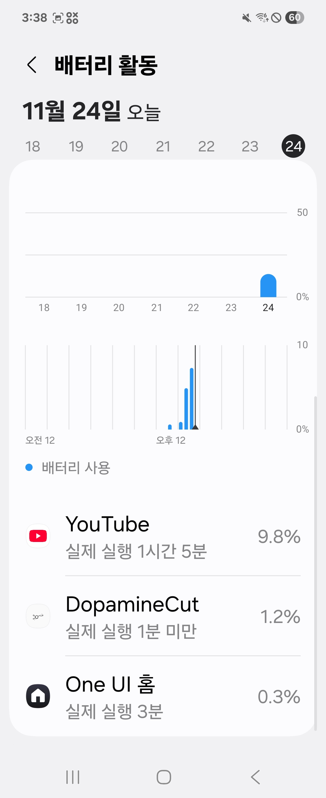
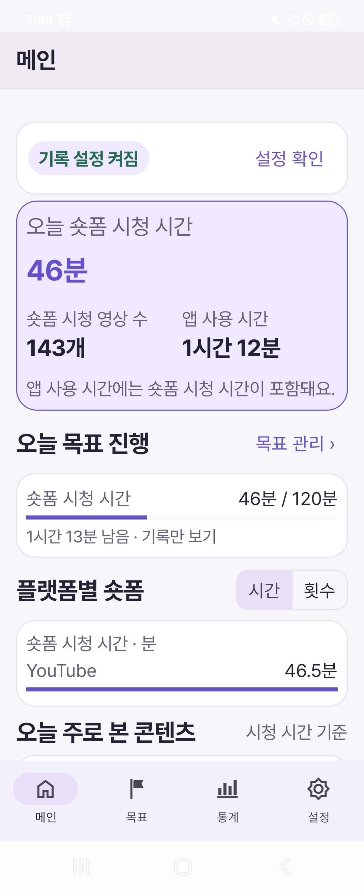

# 도파민컷 배터리 사용량 측정 결과

## 1. 시험 환경 및 조건

| 항목 | 내용 |
|---|---|
| 기기 | 삼성 Galaxy Z Flip3 (SM-F711N) |
| 운영체제 | Android 15 |
| 시험 일시 | 2026년 11월 24일 14:35~15:35 (1시간) |
| 사용 방식 | YouTube Shorts를 영상당 20초 시청한 뒤 전환, 총 180회 스와이프 |
| 도파민컷 동작 조건 | 접근성 서비스 및 기기 내 CV·OCR 처리 활성화 |

## 2. 배터리 소모량

| 측정 항목 | 결과 |
|---|---:|
| 시험 전 기기 배터리 잔량 | 72% |
| 시험 후 기기 배터리 잔량 | 60% |
| 기기 전체 배터리 잔량 감소 | 12% |
| 유튜브 배터리 잔량 감소 | 9.8% |
| 도파민 컷 배터리 잔량 감소 | 1.2% |

### 배터리 사용 및 도파민 컷 실행 화면

첨부한 이미지에서 이번 측정에서 도파민컷에 누적된 시청 기록과 기기에 표시된 앱별 배터리 사용량을 확인할 수 있습니다.
