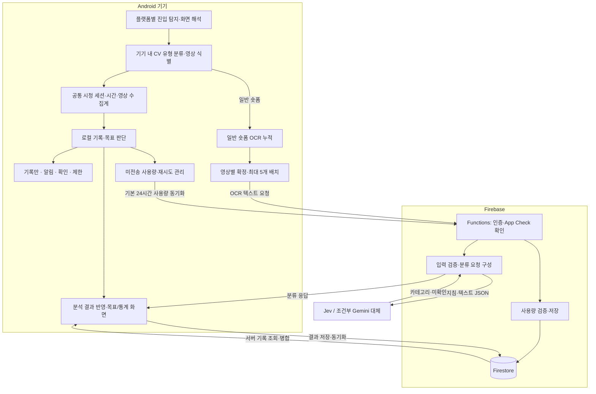
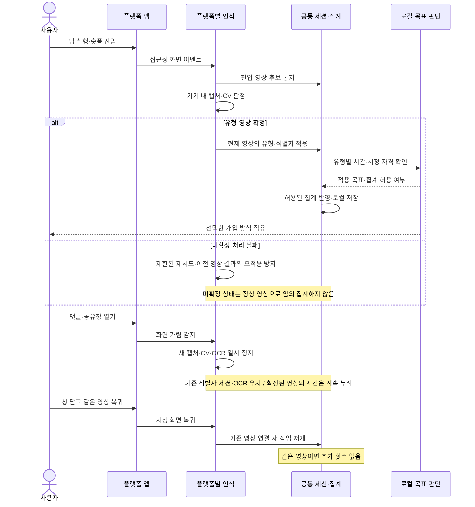
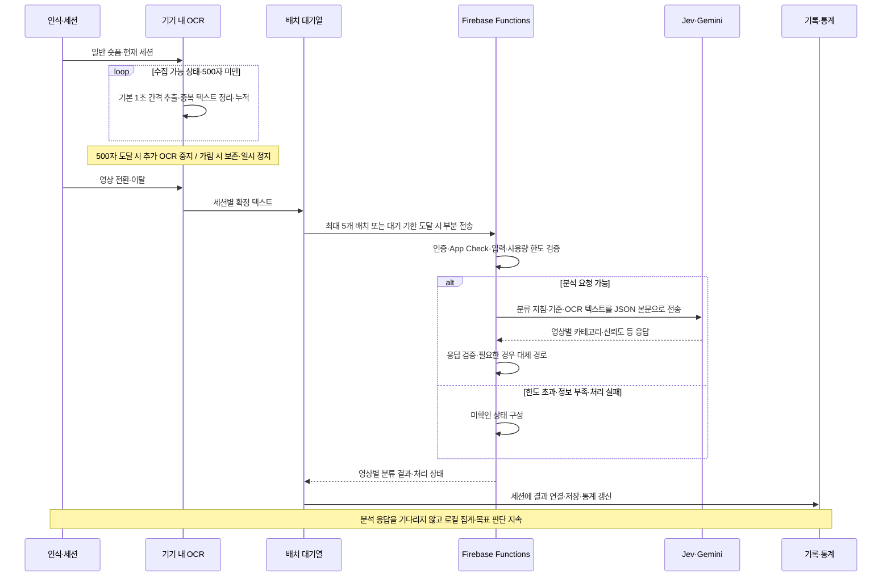
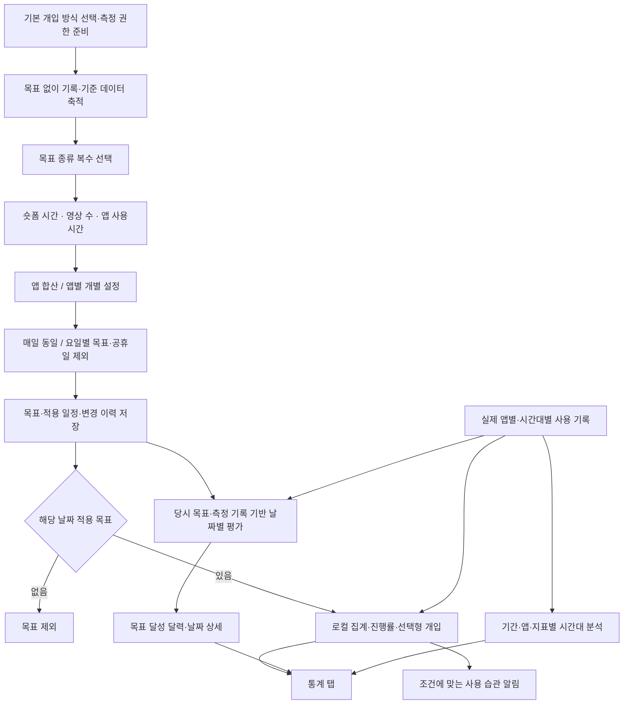

# 2. 전체 기능 소개

## 1. 프로젝트 시스템 개요

본 시스템은 YouTube·Instagram·카카오톡의 일반 기능을 유지하면서 숏폼 시청을 선택적으로 관리하는 안드로이드 앱이다. 플랫폼별 진입 탐지·화면 해석과 공통 식별·시청 집계·목표 처리를 분리하고, 다음 두 흐름으로 동작한다.
> 1. 앱 사용시간·숏폼 시청 집계와 목표 판단·개입
> 2. 일반 숏폼의 OCR 텍스트 수집과 비동기 서버 카테고리 분석

앱 사용시간은 숏폼 여부와 별도로 측정한다. 숏폼 진입 후에는 기기 내 CV로 유형을 판별하고 영상 식별자와 세션을 관리하여 시청 시간·영상 수를 집계한다. 목표 판단은 로컬 집계로 수행하며, OCR이나 서버 응답이 지연되어도 이를 기다리지 않는다.

일반 숏폼의 OCR 텍스트는 영상별 최대 500자로 누적하고 전환·이탈 시 확정한 뒤 최대 5개 단위로 서버에 전달한다. 서버는 분류 지침·카테고리 기준을 결합하여 외부 AI에 요청하고, 반환 결과를 카테고리 기록·통계에 반영한다.

## 2. 시스템 전체 블록 다이어그램

화면 이미지는 기기 내 CV·OCR 처리에 사용하고 카테고리 분석 서버에는 OCR 텍스트를 전달한다. 목표 설정 저장은 기본 24시간 사용량 업로드와 별도로 처리하며, 실제 저장 경로별 권한 검증을 적용한다.

## 3. 시스템 시퀀스 다이어그램

### 실시간 인식·집계·목표 개입

영상 수 제한에 도달한 뒤에는 다음 일반 영상의 집계 자격을 확인할 때 개입 여부를 먼저 판단한다. 제한으로 시청을 허용하지 않은 영상을 영상 수에 먼저 추가하지 않는다.

### 비동기 OCR·서버 카테고리 분석

## 4. 블록 단위 다이어그램 기반 핵심 기능 설명

> **1. 앱 실행 감지 모듈**
> YouTube·Instagram·카카오톡의 실행·이탈과 화면 상태를 확인한다. 앱 사용시간 측정과 숏폼 진입 탐지를 구분하고, 플랫폼별 UI 해석 결과를 공통 처리에 전달한다.
>
> **2. 사용 시간 관리 모듈**
> 경과시간은 기기의 단조 시계를 사용하여 앱 사용시간과 숏폼 시청 시간을 별도로 누적한다. 목표 판단은 서버 분류와 독립적으로 처리하고, 고정된 70% 경고·3분 간격 경고·3회 후 강제 종료 대신 목표별로 선택한 개입 방식을 적용한다.
>
> **3. 숏폼 탐지 모듈**
> 접근성 이벤트와 플랫폼별 진입 단서로 시청 화면을 판단한 뒤 CV 작업을 연결한다. 영상 전환·미확정 재시도와 현재 세션의 유효성을 확인하여 뒤늦게 반환된 이전 영상 결과가 새 영상에 반영되지 않도록 한다.
>
> **4. 콘텐츠 유형 및 중복 필터 모듈**
> 1. 기기 내 CV 판정과 플랫폼별 UI 단서를 사용하여 지원되는 콘텐츠 유형을 구분한다.
> 2. YouTube는 일반 숏폼·광고·라이브·사진 게시물의 4유형을 구분하며, UNKNOWN은 미확정 처리 상태이다.
> 3. 공통 집계 기준은 일반 숏폼의 시간·영상 수 반영, 광고의 숏폼 시간·영상 수 제외, 지원되는 라이브·사진 유형의 시간만 반영이다. 앱 사용시간은 별도로 누적한다.
> 4. 영상 식별자와 시청 세션을 유지하고 플랫폼별 최근 집계 식별자 최대 3개로 재집계를 줄인다.
>
> **5. 시청 의도 검증 모듈**  
> 사용자가 3~5초 사이의 랜덤 시간 동안 영상을 시청했을 경우에만 실제 시청으로 인정한다. 단순 스크롤을 필터링하는 역할을 수행한다.
> 
> **5. 시청 의도 검증 모듈**
> 일반 숏폼은 기본 5초의 집계 조건과 목표에 따른 시청 허용 여부를 확인하여 영상 수를 반영한다. 랜덤 3~5초 기준을 사용하지 않는다. 이미 집계한 같은 영상의 식별자가 유지되면 같은 세션에서 횟수를 반복 추가하지 않는다.
>
> **6. 영상 캡처 및 OCR 모듈**
> 1. 일반 숏폼에서 기본 1초 간격으로 콘텐츠 영역을 캡처·인식한다. 실제 처리 간격은 작업 시간에 따라 늘어날 수 있다.
> 2. UI 문구와 중복 인식 결과를 정리하며 하나의 텍스트로 누적하고, 영상당 최대 500자에 도달하면 추가 OCR을 중지한다.
> 3. 전환·이탈 시 현재 영상 텍스트를 확정한다. 댓글·공유창에서는 새 캡처·CV·OCR만 정지하고 기존 입력을 유지한다.
>
> **7. 데이터 정제 및 AI 연동 모듈**
> 1. 세션별 OCR 텍스트를 최대 5개 배치로 모으되, 대기 기한이 지나면 일부 항목만 전송할 수 있다.
> 2. Firebase Functions에서 인증·App Check·입력·사용량 한도를 확인한 뒤 분류 지침과 카테고리 기준을 결합한다.
> 3. 서버에서 Jev 요청을 수행하고 정해진 실패 조건에 한해 Gemini 대체 경로를 사용한다.
>
> **8. AI 분석 및 결과 반영 모듈**
> 1. 응답을 검증하고 9종 카테고리 또는 미확인 상태를 해당 영상 세션에 연결한다.
> 2. 정보 부족·한도 초과·실패를 임의의 카테고리로 대체하거나 도파민 벌점으로 환산하지 않는다.
> 3. 결과를 기록·통계에 반영한다. 사용량은 로컬에 보관하고 기본 24시간 간격의 검증·동기화와 실패 재시도를 적용하며, 조회 시 로컬·서버 기록을 날짜와 동기화 상태에 따라 병합하여 중복 합산하지 않는다.

## 5. 목표 관리 및 사용 변화 확인 기능

 본 시스템은 사용자들이 숏폼 사용을 줄이는 과정에서 서로의 경험을 공유하고, 동기부여를 받을 수 있도록 웹 기반 커뮤니티 기능을 제공한다.  
 앱 내부에서는 커뮤니티 기능을 직접 구현하지 않고, 앱 화면 하단 또는 메뉴에 위치한 **커뮤니티 버튼**을 클릭하면 웹 커뮤니티 페이지로 이동하는 방식으로 구성한다.

 커뮤니티 웹 페이지에서는 사용자가 게시글을 작성하고, 다른 사용자의 글을 확인하며, 댓글과 공감 기능을 통해 서로 소통할 수 있다.  
 또한 단순한 자유 게시판뿐만 아니라, 사용자의 관심사와 지역 정보를 기반으로 한 광고성 글이나 추천 글도 함께 제공할 수 있도록 설계한다.

> **1. 최초 실행 및 측정 준비**
> 기본 개입 방식 선택 → 측정 권한 준비 → 목표 없이 기록을 시작한다. 약 3일간의 기록을 바탕으로 목표 설정에 필요한 일일 평균 등 기준을 제공한다.
>
> **2. 복수 목표 관리**
> 숏폼 시청 시간·영상 수·앱 사용시간 목표를 동시에 설정하고 수정·중지·복원한다. 목표 수치는 각각 목표 시청 시간·목표 시청 영상 수·목표 앱 사용 시간으로 표시한다.
>
> **3. 요일별 일정 및 공휴일 제외**
> 매일 동일한 목표 또는 요일별 다른 목표를 설정한다. 요일 해제·공휴일 제외는 해당 날짜의 목표 미적용으로 처리하며, 목표값 0의 제한으로 바꾸지 않는다.
>
> **4. 적용 앱 및 합산·개별 설정**
> 세 앱의 사용량을 하나의 목표로 합산하거나 앱별 목표값을 개별로 설정한다. 목표 종류별 적용 범위와 해당 날짜의 일정에 맞춰 진행률·개입을 계산한다.
>
> **5. 선택형 개입**
> 기록만·알림·확인·제한 중 선택한 방식으로 동작한다. 숏폼 목표는 일반 기능까지 일괄 차단하지 않고, 앱 사용시간 목표는 앱 전체 사용에 적용한다.
>
> **6. 목표 달성 달력**
> 통계 탭에서 월별로 달성·일부 달성·초과·기록 부족·목표 제외·오늘 상태와 날짜별 상세 내용을 확인한다. 지난 날짜는 당시 적용된 목표와 이력을 기준으로 판단하고, 현재 목표로 과거 결과를 일괄 재계산하지 않는다.
>
> **7. 시간대별 사용 분석**
> 전체 또는 앱별로 기간과 시간·영상 수 지표를 선택하고 사용이 집중되는 시간대를 확인한다. 시간은 실제 측정 구간을 시간 경계에 맞춰 나누며, 영상 수는 실제 집계 시각에 배치한다. 시간대 기록이 없는 과거 일일 합계를 임의 비율로 나누어 실제 측정값처럼 표시하지 않는다.
>
> **8. 사용 습관 알림 및 측정 상태**
> 사용 습관 알림은 오전·점심·늦은 저녁을 선택하며 기본 시간은 08시·12시·21시이다. 조건에 맞는 내용을 중복 없이 최대 하루 3회 제공하고, 권한·측정 상태 안내와 목표 알림은 별도 기준으로 관리한다.

## 6. 목표·통계 구조 다이어그램

목표 달성 달력과 시간대별 분석은 통계 탭에서 제공하며, 목표 설정·수정·중지·복원은 목표 탭에서 관리한다.
